# Enhanced

**[Join the official Discord](https://discord.gg/dKNCxwM5JE)** for news, help, bug reports and ideas.

A Minecraft mod where you can become one of the *Enhanced*:
**Magneto**, the Master of Magnetism; **Wanda Maximoff, the Scarlet Witch**;
**Quicksilver**, who slows the world down around him (to his own song) or just outruns it;
**Vision**, the Mind Stone in a synthetic body (or **White Vision**);
Wanda's sons **Tommy (Speed)** and **Billy (Wiccan)**; **Loki**, the God of Mischief;
**Jean Grey, the Phoenix**, who reads minds and burns with cosmic fire;
**Peter Parker, Spider-Man**, who goes everywhere on a web;
or, if you are worthy, **Thor**, with **Mjolnir** and **Stormbreaker**;
**Agatha Harkness**, whom the Darkhold makes; **Cyclops**, whose eyes only his ruby-quartz glasses hold back;
**Professor X**, young or old, who hears every mind and takes over bodies; **Doctor Strange**, whom the Eye of Agamotto makes;
**the Hulk**, whom a gamma beam makes; or, from the X-Men's secret lab under the Mutant School, **Wolverine** and **Deadpool**,
whose healing factor gets them back up from anything but the strongest powers. In the Avengers Tower wait the **Avengers**:
a **Super Soldier Serum** makes you **Captain America**, **Red Hulk** or **Falcon**, and an **Arc Reactor** makes you **Iron Man**,
with six suits; and in the End, **Eternity** grants one wish, which can make you **Love**, Thor's daughter. The six **Infinity Stones** wait in the worlds,
and the **Stone Locator** points the way to them. In the woods, **Agatha**, her son **Nicky** and **Rio, the Green Witch**,
live happily together, and when you die, Rio lets you choose where to start again. In Creative mode the **Hero Creator**
turns you into any hero, or into a hero of your own.
Three villains are bosses, and their powers are won only by beating them: **Thanos**, the Mad Titan,
who gathers up to five Infinity Stones as he fights; **Ultron**, the AI of the Mind Stone, who lifts the ground
into the sky and whose Core makes you Ultron; and En Sabah Nur, **Apocalypse**, a boss you beat to earn his Essence.

Every power's look and colour follows the MCU films and shows, and Vision, Tommy, Billy, Loki
(in his Asgardian clothes, the TVA's or the God of Stories'), Thor, the Phoenix, Spider-Man, Thanos, Ultron, Apocalypse, Agatha, Cyclops, Professor X, Heimdall, Odin, Hela, Doctor Strange, the Hulk, Wolverine, Deadpool, Captain America, Red Hulk, Falcon and Love each have several looks
(press **H**; for Iron Man, **H** puts on his suits).

**New in 3.8:** Eilon's Avengers. The [Super Soldier Serum](docs/wiki/Super-Soldier-Serum.md), in the Avengers Tower's lab: use it and choose your super-soldier on a screen of three cards. [Captain America](docs/wiki/Captain-America.md) (Speed II, Strength II and Resistance I; the **Vibranium Shield** blocks everything from the front, bounces arrows back, and comes back to his hand when he throws it, or ricochets from foe to foe first; the Slam, the Charge, Assemble and Inspire, the Combat Combo; worthy of Mjolnir; two suits), [Red Hulk](docs/wiki/Red-Hulk.md) (1.5 times as big, fire can't hurt him, and his **Anger** fills as he fights until it bursts in a ring of fire; the Ground Smash, the Heat Wave, a Super Jump you charge, the Energy Absorb, and Ross) or [Falcon](docs/wiki/Falcon.md) (the **Exo-Wings** from the top of the tower: flight, an elytra glide, the Dive, the Boost Climb, the Wing Shield, wrist blasters, and **Redwing**, the drone that marks monsters and zaps them). [Iron Man](docs/wiki/Iron-Man.md): an **Arc Reactor** from Tony's desk makes you Iron Man, and the workshop has **six suits** on their displays, each with its own moves and **its own suit-up animation**, put on with **H**: the Mark 1, the Mark 3, the Mark 5 suitcase, the nanotech Mark 50 and Mark 85 (energy blades, a giant shield, homing missiles, drones) and the Hulkbuster that Veronica drops from the sky; suit energy, flight and a helmet HUD. [The tower's armoury](docs/wiki/Structures.md#the-armoury-38) gives one of each to each player, and **old towers are refitted by themselves** when you come near (`/enhanced structure refit_tower`). [Eternity](docs/wiki/Eternity.md): the **Shrine of the Cosmic Entities** in the End; a key of the Bifrost on its altar takes you to Eternity's realm, where you may make **one wish**: any item (the Infinity Stones and Gungnir by their own rules), or to become [Love](docs/wiki/Love.md), Thor's daughter, with Stormbreaker, lightning and a purple eye laser. The Hero Creator: 221 cards. 109 new sounds and a new Avengers advancement tab. The server and every player need 3.8 (network protocol 12).

**New in 3.7.2:** Asgard's dining hall is fixed: in the [Hall of Feasts](docs/wiki/Asgard.md#the-city) the tables are the right height with the dishes on them, the high table has its seats, the lanterns hang from the ceiling, and Volstagg sits at his place to eat; at dusk the Warriors Three and Sif join him for the feast. A hall built before is mended by itself. On Death's screen Rio says "All roads lead to me." and wears her Death look from *Agatha All Along*. Works with 3.7 servers and players (network protocol 11, unchanged).

**New in 3.7.1:** Wanda's [Hex Runes](docs/wiki/Scarlet-Witch.md#hex-runes) look like the *WandaVision* finale: huge glowing scarlet runes drawn stroke by stroke, several on each of the Hex's four walls, readable from inside and outside, and they grow with the Hex. Avengers Tower no longer logs errors about its item frames. Works with 3.7 servers and players (network protocol 11, unchanged).

**New in 3.7:** two heroes with a shared [healing factor](docs/wiki/Healing-Factor.md) (a deadly blow only knocks them down for 5 seconds; only the Infinity Stones, chaos magic, Odin's power, the Phoenix or poison defeat them, and poison switches the healing off): [Wolverine](docs/wiki/Wolverine.md) (an Adamantium Injection: claws, the Claw Slash and Spin, the Pounce, the Berserker Rage, the Sniff and Track, Claw Climb; heavy enough to sink, and Magneto can lift him; the classic yellow suit and the *X-Men* leather) and [Deadpool](docs/wiki/Deadpool.md) (the Weapon X Pod: katanas and the Parry, cartoon pistols and the Trick Shot, a glitchy Teleport Belt and the Drop-In, the Taunt, the Chimichanga Break, Dogpool, and forty-two jokes of our own; three looks, Kidpool too). [The X-Men lower lab](docs/wiki/Mutant-School-Lab.md) is built under every Mutant School, old ones too, with no hole in the world: two bookshelves in the Professor's study swing open onto a lift; down there are the medical bay and its **Cure Station** (a Mutant Cure for a glass bottle), the Weapon X lab with the injections' rack and the pod, and the great sphere of **Cerebro**, where a telepath at the console finds every player in every world for 30 seconds, as stars round the room, with the nearest stone sites (`/enhanced structure school_lab`). The [Stone Locator](docs/wiki/Stone-Locator.md): 4 netherite blocks, 3 diamond blocks, a wither skeleton skull and an Infinity Stone in the middle, which comes back; its needle points to the nearest place with a stone you haven't got. [Agatha's Cottage](docs/wiki/Agathas-Cottage.md) in the forests: Agatha, Nicky and Rio, the Green Witch, live happily together, cook, garden, play and eat dinner at dusk, talk, trade, give gifts and blessings, and ask you to find Señor Scratchy the rabbit; the cellar has a working Witches' Road door and Agatha's study chest holds the Darkhold. And [meeting Death](docs/wiki/Meeting-Death.md): when you die, Rio lets you start again, or start again in the Nether. The Hero Creator: 176 cards. The server and every player need 3.7 (network protocol 11).

**New in 3.6.1:** the Soul Stone can be earned again at Vormir (a push from the edge counts, a pet no longer teleports back on the way down, a cat, a horse or a hero who lands alive is taken all the same, anyone can earn it, and you are told why a push didn't count); Gungnir is one per world; Tommy runs on water like his uncle; and Avengers Tower is rebuilt after the films, with a room for each of the six (Captain America's is a closet).

**New in 3.6:** the six [Infinity Stones](docs/wiki/Infinity-Stones.md) are real items, each with two powers: the Reality Stone in Asgard's vault, the Mind Stone in Loki's Scepter and the Space Stone in the Tesseract (craft either alone), the Time Stone in a new **Sanctum Sanctorum**, the Power Stone in the Orb at the end of a new **End tunnel**, and the Soul Stone at the new **Vormir Cliff** in the Nether, given for a sacrifice ([Vormir](docs/wiki/Vormir.md): push a friend, with PvP on, or your pet off the edge; the friend loses his things and his power). Only the gods, the Scarlet Witch and the Phoenix may hold a bare stone (a sorcerer the Time Stone, Vision the Mind Stone); anyone else is burned. The vessels (Loki's Scepter, the Tesseract, the Eye of Agamotto) let others use theirs; the Reality, Power and Soul Stones have none. A crafted **Infinity Gauntlet** takes real stones: **J** picks one, holding **J** opens the Stone Wheel, and all six **Snap** (half of the hostile monsters near turn to dust). **Avengers Tower** holds a Tesseract. Two new heroes: [Doctor Strange](docs/wiki/Doctor-Strange.md) (hold the Eye of Agamotto with no power: the Eldritch Whip, the Cloak, the Seraphim shields, the Crimson Bands, Astral Projection, portals, the Mirror Dimension, and the Eye on **Y**; with the Eye, Billy and Agatha get the Time Stone's powers; the Sling Ring for every sorcerer) and [the Hulk](docs/wiki/Hulk.md) (stand in a Gamma Emitter's beam: Bruce Banner and two Hulks, Smash, Thunder Clap, Super Leap, boulders, Gamma Charge, Rage). [Hydra soldiers](docs/wiki/Hydra-Soldiers.md) guard every Hydra outpost (riflemen, enforcers, a sniper, an officer, an alarm with reinforcements; the blaster and a map to Avengers Tower). The Hero Creator: Doctor Strange's and the Hulk's abilities and a stone row for each stone. Fixes: beams are drawn in the third-person back view, and the stone beam's arm is raised. The server and every player need 3.6 (network protocol 10).

**New in 3.5:** [Asgard](docs/wiki/Asgard.md), the Realm Eternal: a golden city floating over a sea of stars (Odin's palace and throne room, the Rainbow Bridge, Heimdall's Observatory, gardens, halls, training grounds, waterfalls off the edge into space), a world of its own that **only the Bifrost reaches** (the Bifrost answers Mjolnir, Stormbreaker, Hofund, your own Gungnir, Heimdall and Odin; with no power, a **Bifrost Rune Stone** in the Overworld), safe to explore. Every Bifrost, Thor's too, now **takes everyone in its circle** (`bifrost.groupRadius`, `bifrost.sneakToStay`). Three new heroes: [Heimdall](docs/wiki/Heimdall.md) (win his Guardian's Watch and hold Hofund), [Hela](docs/wiki/Hela.md) (a boss in the throne room: three phases, berserkers and Fenris; wear her Headdress) and [Odin](docs/wiki/Odin.md) (take Gungnir from his vault and sit on the Throne of Asgard); [the Asgardians](docs/wiki/Asgardians.md) talk (English and Hebrew), trade, train and fight beside you. [Music](docs/wiki/Music.md): Quicksilver's own theme *Silver Hours* (*Sweet Dreams* is a client option), Speed's Walkman with *Westview Blur*, a new version of the Road's ballad for the choice, and a world music folder whose songs every player downloads. The Hero Creator: every ability in its own colour (a colour picker), and every Sneak variant a card of its own. Fixes: `/enhanced structure repair_school`, a tougher Loki, Agatha's drain only on sorcerers, the *Brand New Day* suit redrawn, the unsaved-changes prompt, and the old hero's headgear into your bag on a hero change. The server and every player need 3.5 (network protocol 9).

**New in 3.4:** the [Hero Creator](docs/wiki/Hero-Creator.md) makes heroes as good as the mod's own: **all 81 abilities of the sixteen heroes** are powers a custom hero can pick (each the hero's own code, with its Sneak variant, effects, sounds and moves; the list is on [Heroes' Abilities](docs/wiki/Hero-Abilities.md)), mixed with the thirty powers, each with a strength slider, on **R G V B N** alone or with **Sneak**, within a budget of 90 points and 10 powers; powers of different heroes that drive the same thing (one shield, one grip, one beam...) cannot go together; every power plays a gesture and a stance, and you choose how your hero flies, runs and stands; a cape, a hat, a mask, glowing eyes and an aura go on top of the skin; a new editor with a moving 3D preview, ready-made heroes, categories and search in English and Hebrew; **Choose a Hero** gives the hero's own items (Thor's Mjolnir, claimed; Agatha's Darkhold...), never twice; hero files of 3.3 load and turn into the new format (version 2) by themselves. The server and every player need 3.4 (network protocol 8).

**New in 3.3:** three new heroes: [Agatha](docs/wiki/Agatha.md) (read the Darkhold with no power: its purple beam, flight, the Power Drain, a witch's shield and a Rune Trap), [Cyclops](docs/wiki/Cyclops.md) (put on his ruby-quartz glasses: the Optic Blast, and a giant beam whenever they come off) and [Professor X](docs/wiki/Professor-X.md) (craft his wheelchair: hear thoughts, take over bodies, Cerebro; young or old); the [Hero Creator](docs/wiki/Hero-Creator.md) (Creative: become any hero, or make your own from thirty powers with a strength each, your keys, colours and skin, saved as JSON); [Hydra outposts, Mjolnir's craters and the Mutant School](docs/wiki/Structures.md) in the world (Loki's Scepter is now found only in the outposts' vaults); Billy's Hex Barrier stops everything from the front, with 30 health and no time limit, and chaos magic shatters it; Wanda's Hex lets in only those she approves and no power crosses its wall, and her **Hex Runes** silence every other sorcerer inside; the ward of the Book of the Vishanti keeps out monsters, bosses, what they shoot and dark magic; the Witches' Road plays an original ballad in a new arrangement at each stage; Quicksilver and Tommy each get separate **slow time** (R) and **super speed** (G) keys, **run up walls and along ceilings**, and new attacks (Dash Strike, Pebble Barrage, Sonic Boom); Spider-Man's **Web Assist** makes swinging easy in forests and open land (J switches it); and smoother animations everywhere.

**New in 3.2:** the Witches' Road has three **trials** (a parkour over the void, a structure to copy block by block, an ice-boat race; see [The Witches' Road](docs/wiki/Witches-Road.md)) and you choose Billy or Tommy at the end; Billy fires a continuous **Hex Beam** (hold **R**), raises a **Hex Barrier** (Sneak + **B**) and ranks up to **ten** ranks; Wanda's Chaos Shield is **unlimited** and she can build **instantly** (Ctrl + I); sorcerers can craft the **Book of the Vishanti** (saved places, and a ward round the base that no monster can enter) and the **Darkhold** (Agatha's purple beam; see [The Sorcerers' Books](docs/wiki/Sorcerers-Books.md)); and Apocalypse is weaker (one master factor, `apocalypse_boss.powerFactor`).

**New in 3.1:** Wanda and Billy build with **Build Magic** (press **Y**; eleven spells, and **Ctrl + Z** takes it back, even tomorrow; see the [Build Magic page](docs/wiki/Build-Magic.md)), every telekinesis works in the boss fights and Billy moves blocks, Magneto pulls the metal out of everything around him, and Apocalypse never heals while Wanda and the Phoenix hit him critically.

Original hero concepts by Eilon Kolodkin-Gal. The full design, with every rule and
number, is in [docs/DESIGN.md](docs/DESIGN.md) (Hebrew: [docs/DESIGN.he.md](docs/DESIGN.he.md)).

**Wiki:** the player's guide, in English and Hebrew, is on the [wiki](../../wiki). Its pages live in
[docs/wiki](docs/wiki) and a GitHub Action publishes them, so edit them there.

**Download:** every push to `main` builds the mod, runs the in-game tests and publishes the jar
on the [Releases](../../releases) page. The newest build is always marked *Latest*.

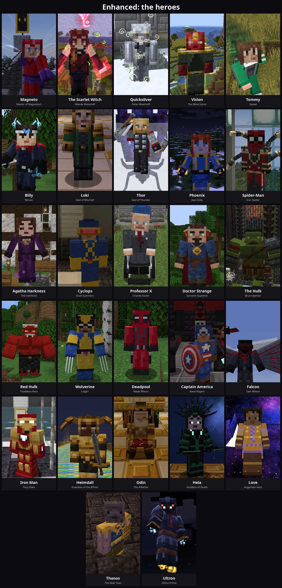

| Magneto | Scarlet Witch | The Hex |
|---|---|---|
| 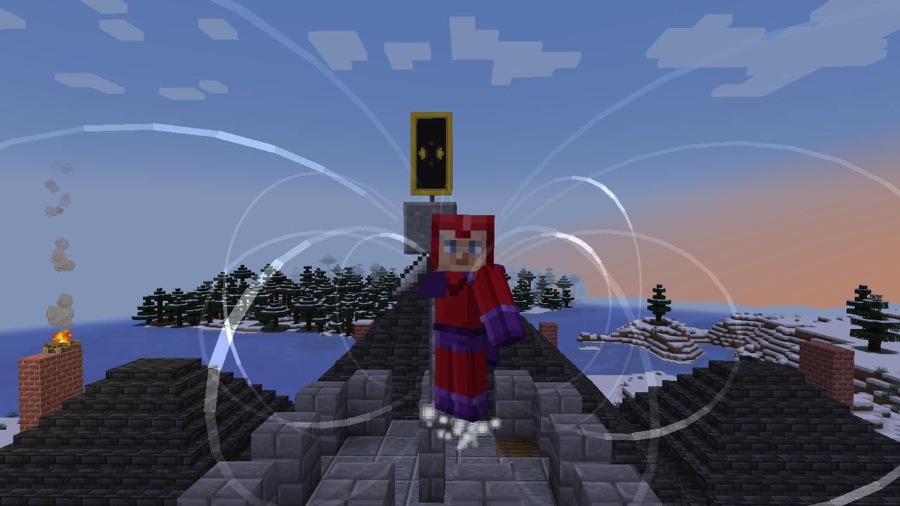 | 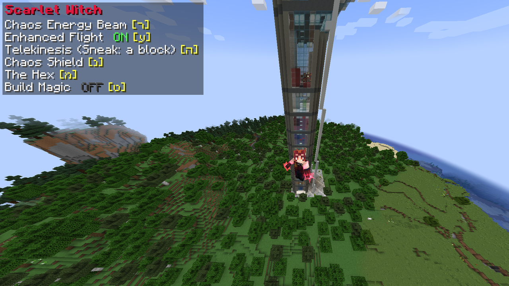 | 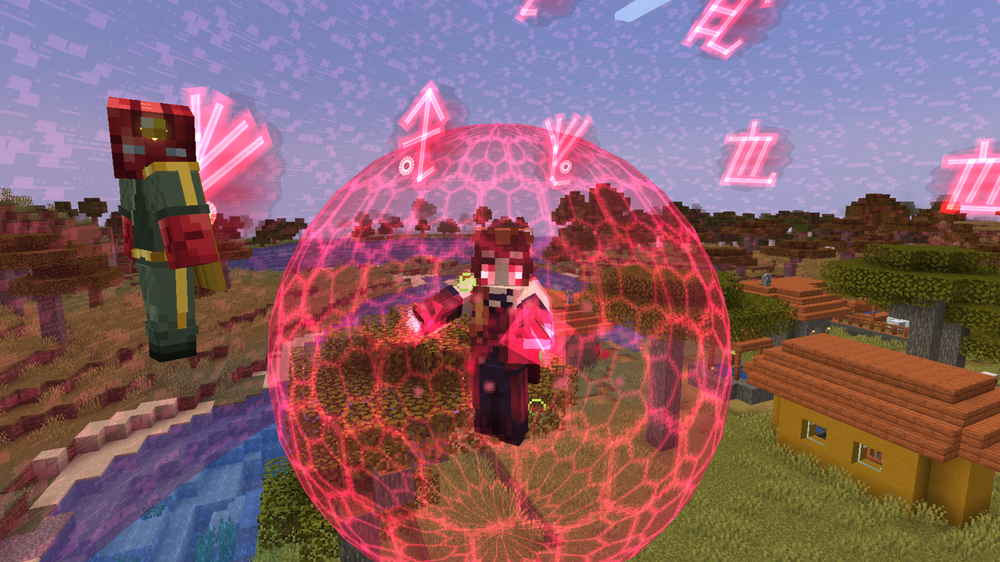 |

| Quicksilver | Vision | Wolverine |
|---|---|---|
| 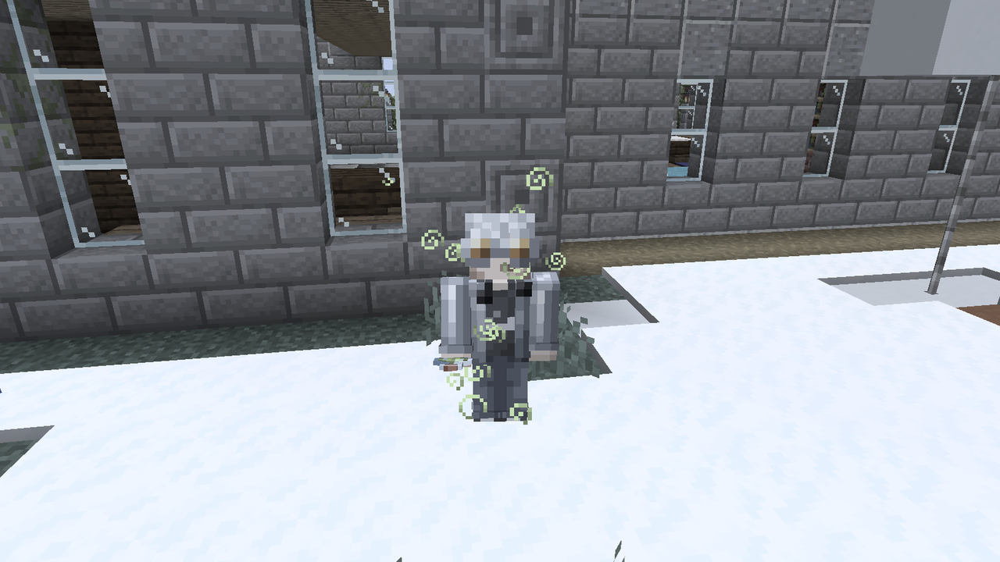 | 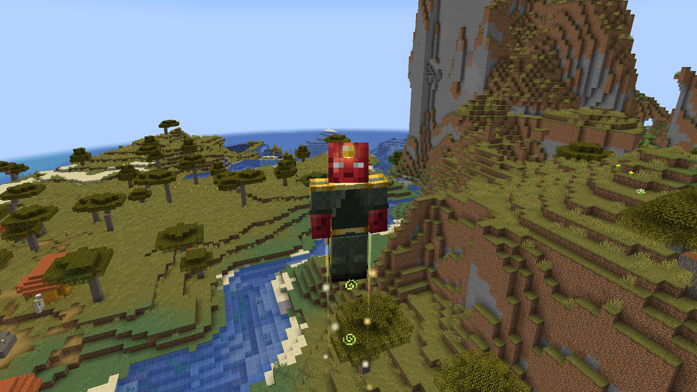 | 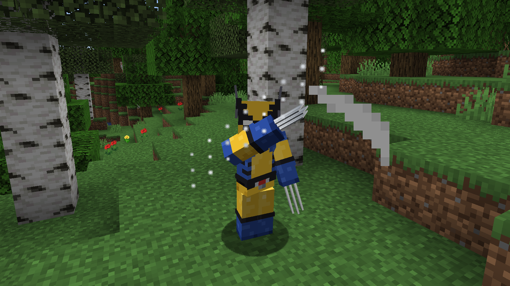 |

* **Minecraft** 1.21.1, 1.21.4, 1.21.11 or 26.3 (the same jar)
* **Mod loader** NeoForge 21.1.x, 21.4.x, 21.11.x or 26.3.x
* **Install it on** the client, plus the server for multiplayer

## What's new in 3.19.0

* **The Multiverse.** Every place belongs to a universe: **Earth-616**, the main one, where a new world starts (every structure but the Mutant School); **Earth-10005**, the X-Men's, the only universe with the **Mutant School** now; **Earth-2149**, the zombies', where helmeted zombies walk by day and night, four times as many as a normal night, and every village is abandoned; and **endless What If universes**, as in the April Fools infinite dimensions: a renamed item names one by a number or by any words, and each asks its own question (What If... Gravity Failed? the Dead Rose? Everyone Was Quicksilver?...). See [The Multiverse](docs/wiki/Multiverse.md).
* **Three ways between them**, each with a Multiverse screen: the **Darkhold's Dream Walking** (Sneak + use, looking straight down), the **Sling Ring of a cosmic hero** (Billy the Demiurge, Cosmic Spider-Man: portals to the other universe), and **Reed Richards' Multiverse Bridge** (8 netherite blocks round an empty middle): a great ring that, powered by redstone, sends whoever stands in its middle.
* **The other universes' Infinity Stones** lie in chests, one of each per universe (the first copy taken is the stone, the others fade away), and a stone works only in its own universe.
* **Ultimate Wanda, the Sorceress Supreme** (needs Ultimate, as Billy the Demiurge does: Sneak + G as the Scarlet Witch). Twenty hearts, a netherite set's protection, every power eight times as strong, twice the healing, a faster flight, no recharge on anything. **H** switches her menu (the Scarlet Witch's keys, or her own), **Sneak + H** her hair (the films' red or the comics' black). Her own menu: **R** takes over the universe she stands in (its sky turns red for everyone in it; any number of universes at once; Sneak + R lets them all go), **B** lights runes in the skies of her universes that take the powers of every player under them, each one making her stronger (Sneak + B: her Chaos Shield), **V** takes over a body from 30 blocks like Professor X, with no time limit, any telepath's too, while a shield guards her own body (Sneak + V: reading minds as Jean Grey does, in red). She comes back a second after she dies, with all her health; nothing freezes her; the Hex Runes do not hold her and every Hex lets her through.
* **What If universes, more of them.** Gamma Bomb, Hydra Won and Ultron Won, and random universes made from any name, each different. Survivors talk in their own words and live in bunkers; a freed Hydra world stays free; Earth-2149 has a zombie of every creature, hunting on sight. Travel between universes has its own animations.
* **Ultimate Wanda grows.** Banishment to the **Nexus** between the universes, **red portals**, her own red **Eye of Agamotto** (N in her menu: it reveals the hidden, holds her foes, burns the dead and demons; Sneak: the All-Seeing Eye, 50 blocks), a **Chaos Shield nothing gets through**, a **Hex with no size limit**, a giant chaos beam (Sneak + R in the Scarlet Witch's menu) and the **Chaos Energy Eruption** (B in her Multiverse menu). She wears the Sorceress Supreme look (Sneak + H: ginger or dark hair), and her red sky has real runes in it.
* **Jean Grey, much stronger.** A bigger Phoenix Burst and firebird; telekinesis in orange with no lightning; **all her energy orange**, her force field (Sneak + G) a sphere of **burning orange fire**; she heals five times as fast as a player, fire and lava never hurt her, and her body is armoured like diamond. **Body takeover** (B at a player or at her own host): she steers the body for as long as she likes, at any distance; the Scarlet Witch, Billy and Spider-Man are immune. **Matter Manipulation** (Sneak + N, or the Build Magic key): the Scarlet Witch's Build Magic in her orange, unlimited for now (`phoenix.matterUnlimited`). A new **Brand New Day** look: a near-black green leather jacket over a yellowish olive hoodie and hood.
* **Red Skull and Captain Hydra** are heroes of their own, with Hydra's suit and shield and Hail Hydra.
* **Billy the Demiurge's Hex Barrier** never wears down and stops everything.
* **The Darkhold and the Book of the Vishanti** have new looks and pages you can read (K).
* Fixes: no crash placing the Horton Manor's signs on 26.3, the Hydra Shield renders on 26.3, the What If looks on 1.21.4 and newer, the Bridge is in the creative tab and arriving no longer freezes.
* The server and every player need 3.19 (network protocol 22).

## What's new in 3.18.3

* **The Nova Flame can be survived.** A full blast of the Human Torch's Nova Flame does 14 damage (it was 24) and burns 4 seconds, 8 at full charge (it was 6 and 12): a player at full health lives through it, and armour and tougher heroes take much less. (New setting names `jim.novaFlameDamage` and `jim.novaFlameBurnSeconds`, so every server takes the new numbers.)
* **Professor X uses the body he takes over.** In a player's body, his ability keys are that body's own powers (its hero's, with Sneak), aimed where he makes it look; his take-over key still brings him back. His right click uses what the body holds: places a block, opens a door, eats, drinks, draws and shoots a bow.
* **The Hulk heals faster:** 1.5 health a second (it was 0.35), from 3 seconds after a hurt (it was 5). Setting `hulk.regenerationPerSecond`.
* **Jumping in slowed time is slow too.** A player inside another's slowed time moved at full speed as soon as he jumped; he is slow in the air now as on the ground.
* The network protocol is 19: players need 3.18.3 on both sides.

## What's new in 3.18.2

* **Helmets and goggles stay on the head.** On Minecraft 1.21.9 and newer (26.3 included), Magneto's helmet, Quicksilver's goggles and any other helmet slid off the head while a hero flew, ran or wall-ran: the armour worked the hero's pose out twice. It is worked out once now.
* **The Demiurge gives more magic.** His gift screen has a **Level** button: the gifted witch starts at that witch level (5 by default: every power he picked at once; lower, and she grows by the levels). Up to 20 powers in one gift (`billy.demiurge.giftMaxPowers`).
* **The Demiurge's Vishanti ward** is one and a half times the Scarlet Witch's (72 blocks by default).
* **The Shields of the Seraphim protect.** Doctor Strange's (and the Eldritch witch's) Shield now stops everything that comes at its front, and the Dome stops everything from outside it; harm from inside the Dome is halved, as before.
* **The Cloak of Levitation's collar** turns with the head, so the head no longer comes through it when he turns or looks up.

## What's new in 3.18.1

* **A level system for witches.** Each of the three spellbooks now starts its caster at level 1 and grows to level 5 by experience: each level opens one more spell on a fixed key and makes the spells stronger, and level 5 is exactly the whole book of before (never stronger than the real hero: every ability of Agatha's or Strange's at most at its strength 5). Experience comes from spells that hit hostile creatures, kills, bosses (400), the book's practice and a daily study at the book's home lectern (60), with a coven bonus near another witch and a cap of 600 an hour; death costs none. Empty keys get small cantrips in the book's colour by role (Mini Shield, Blink Step, Mend, Repel, Spark, Witch Light). The Green witch gains a new spell at level 5, **Root Grasp** (B). A level line and experience bar on the HUD, a title with particles on each level-up (and a word to the whole server at level 5), and the **Book of Spells** screen when you use your book (the Ethereal witch: a button on her hat's screen). Existing casters start at level 5 and nothing changes for them. Settings in `[spellbook_levels]`; commands `/enhanced spellbook xp <players> add|set <n>` and `/enhanced spellbook level <players> <book> <1-5>`.

* **The witches are heroes of their own.** The Ethereal Witch, the Eldritch Sorcerer and the Green Witch are now in the Hero Creator's **Choose a Hero** list after the mod's heroes (a card each, with her book): Become! makes you that witch at once, at your level in her book (level 1 if you never began it), with the creator's usual checks; she keeps your own skin, and her levels work as with the book. Operators can also use `/enhanced power set <players> ethereal_witch|eldritch_sorcerer|green_witch`, and `/enhanced power get` names a witch by her own name. Every spell of the three witches has its own symbol in the drawn HUD styles (Comic, Stack, Dial, Scroll, Cluster), in her colours: her book's spells, their Sneak forms, the Root Grasp and every cantrip (a small sparkle marks a cantrip); a witch of the Demiurge's gift has symbols for her cantrips too.
* **Agatha can drain Cosmic Spider-Man.** Her Power Drain works on him though he is no sorcerer: she gains as from any drain, and it takes 25 of his cosmic power (setting `spider_man.cosmic.agathaDrain`), which he must gather again; drained to nothing, he is plain Spider-Man again.
* **Flying heroes slow down in slowed time.** A hero flying inside another's Quicksilver Time, slow time or Time Stone zone now flies at its speed too (Slowness never touched flight).
* **Billy the Demiurge (needs Ultimate, which is off by default).** Billy's ultimate version, the second after Cosmic Spider-Man: Sneak + N turns Billy into the Demiurge and back. He wears the Demiurge's starry suit with orange shoulders, a red scarf and a red cape; when he flies or uses a power he changes, with a burst of stars, into the star form: a red hood comes up, the cape grows into a great red cloak that fans out round him to the ground and flares wider as he flies, Billy's crown shines over him brighter and bluer, and rings of blue light turn at his hands; he is back to rest when he stops. He has twenty hearts, a netherite set's protection and heals faster; his Hex Barrier (Sneak + B) wraps his whole body; all his powers hit twice as hard and are drawn in a much brighter blue with small stars in the energy. **Magic Types:** H (Sneak + H: back) puts another witch's or sorcerer's magic on his keys, the Scarlet Witch's, Doctor Strange's, Agatha's or Loki's, and back to his own; he keeps the Demiurge's look and their effects turn his blue with stars, and his panel shows which magic he has. **The gift of magic:** Sneak + G opens a screen where he picks a player who has no hero and the magic to give from the Hero Creator's catalogue (magic only: the spellbooks' magic, flight, and every ability of the Scarlet Witch, Billy, Agatha, Doctor Strange and Loki); that player becomes a caster of it in his own skin, until the Demiurge takes it back. Without Ultimate none of it works, and a Demiurge whose Ultimate is taken away is plain Billy again at once. Settings in `[billy.demiurge]`; operators also have `/enhanced demiurge on|off|type|gift|take`.
* **Slowed time runs at a tenth of the normal speed, smoothly, on every version.** Quicksilver Time, Tommy's slow time, the Time Stone's Slow Time (the Infinity Gauntlet, the stone bearers, Doctor Strange's Eye of Agamotto) and a custom hero's Time power (Slow Time) now slow everything in their zone to 10% (was 20%, and a third for the Time Stone): creatures, items, falling blocks, TNT, boats, every vanilla projectile (arrows, tridents, snowballs, potions, fireballs, wither skulls, shulker bullets, llama spit, fireworks, wind charges) and the mod's own (missiles, orbs, bolts, bullets, darts, the thrown shield, Jim Hammond's fireballs, the spellbooks' shots). Creatures glide and move their limbs in slow motion instead of stepping and standing, and on 26.3 they no longer freeze for good. Other players in the zone keep about a tenth of their walking speed. Everything keeps its full strength when it hits, and its full speed once it leaves the zone. Server owners can change it with `quicksilver.slowMotionFactor` and `time_stone.slowFactor`; a world that already has its server config keeps the number saved in it, so set it there with `/enhanced config set quicksilver.slowMotionFactor 10` (and `time_stone.slowFactor 10`).

## What's new in 3.18.0

* **Cosmic Spider-Man (needs Ultimate, which is off by default).** Spider-Man's cosmic transformation: Sneak + N when his cosmic meter (170, a white-blue bar like Iron Man's) is full. Cosmic, he hits three times as hard as the Hulk at full rage, has a netherite set's protection, heals twice as fast, flies like Wiccan with a cosmic trail and aura, and has a wider spider-sense; R fires the Cosmic Blast (Sneak: from his eyes), G shoots webs (no swinging: he flies; Sneak: Web Burst), B opens portals to saved places (Sneak: another world), Y is Matter Restructuring (Billy's Build Magic at two thirds), and H switches between his two cosmic looks (the starfield suit and Captain Universe's). The meter drains while he is cosmic and never refills until it runs out; then he is plain Spider-Man again until it is full. Dark magic hurts him half again as much. His HUD panel turns the cosmic colours. Settings in `[spider_man.cosmic]`.
* **Ultimate.** The ultimate versions of the heroes (Cosmic Spider-Man) work only with Ultimate: `/enhanced ultimate true|false` turns it on or off for everyone (setting `[ultimate] enabled`, off by default), and `/enhanced ultimate grant|revoke <players>` gives or takes it from chosen players while it is off. Operators only.
* **Captain America's shield works again on 1.21.11 and 26.3.** The Vibranium Shield could not be raised there, blocked nothing, and R only said "You need a shield in your hand": from Minecraft 1.21.5 a shield needs the game's "blocks attacks" part, which the Vibranium Shield did not have. It now raises, blocks, is thrown, hits and comes back as on 1.21.1 and 1.21.4.
* **Spider-Man is no longer kicked from servers on 26.3** ("Invalid move player packet received") while he clings to a wall or a ceiling. To keep the server up to date while he hangs still, his client sent its position in a packet of its own beside the game's, and from 26.1 a server kicks a player who sends two positions in one tick. The game's own packet now carries it. His swing also never hands the game a position that is not a number.
* **Iron Man's missiles and other plain-coloured things have their colours again on Minecraft 1.21.11 and 26.3.** Those versions no longer ship the plain white texture they were painted with, so they showed the missing-texture pattern: Iron Man's missiles and suit models, the suit display, Ultron's and Hydra's bolts, Deadpool's bullets and Falcon's darts. The mod now brings its own.
* **The Nova Flame no longer kills everything in one hit.** A full charge now does 24 damage (was 90) and a tap 6 (was 12), and what it strikes burns for 6 seconds (was 10); its fire, magma and explosion are unchanged. Server owners can set the old numbers back with `/enhanced config set jim.novaDamage 90`.
* **Jim Hammond's abilities have their own symbols** in the drawn HUD styles (Comic, Stack, Dial, Scroll, Cluster): a fire beam, flight, a fireball, the Nova sun and the disguise, instead of blank tiles.
* **Jim Hammond's fireball reads in flight and never fills your screen.** It is drawn half again as big, with a tail that grows with its speed, and it fades away as it nears the camera (just thrown in first person, or flying straight at you) instead of covering the view in orange. How hard it hits is unchanged.

## What's new in 3.17.0

* **The server's settings, changed in the game.** An operator reads and changes every setting and limit of the server config without leaving the game: `/enhanced config get|set|reset|list` (Tab completes every key, such as `custom_hero.budget`), and `/enhanced config` opens the mod's settings screen, where on a server an operator now edits the Server Options too. The server checks every change (who asks, the option's own range), uses it at once, writes it to the config file and sends it to every player; a bad value is refused and nothing changes. No setting is renamed and no default changes. See [Commands](docs/wiki/Commands.md).
* **Source Code Vision's beam burns, and starts at his Solar Jewel.** What it hits is set alight, and where it hits the ground it leaves fire and lights what can burn (fire is placed, no block is deleted; never with `mobGriefing` off or where the mod's block rules refuse). The beam leaves the jewel on his brow, in every pose and in first person. Other looks are unchanged. Settings `vision.solar_jewel.beamFire` and `sourceCodeBurnSeconds`.
* **Vision's Density is gone; B is now a Charged Beam** in every look: hold B to charge (a glow builds, a note rises, the HUD counts the charge), release to fire a beam whose damage, reach and width grow with the charge; a tap fires a weak one; then a cooldown. In the Source Code look it also burns and explodes where it strikes, scaled with the charge, breaking blocks only where the mod's block rules allow (never with `mobGriefing` off). Hero Creator: the module Density is replaced by Charged Beam, and a saved hero that picked `vision.density` has the Charged Beam on that key; old saves of a dense Vision load as a normal one. Settings in `vision.charged_beam`.
* **A new hero: Jim Hammond**, the android first Human Torch ([wiki](docs/wiki/Jim-Hammond.md)). In survival the only way is to use the Source Code as a player who is not Vision (Vision's own use of it is unchanged); he is also in the Hero Creator, every ability a module. A **continuous Fire Beam** (hold R: a steady beam of fire follows where he looks, burning what it touches and the ground along it, fed by his solar charge), total **fire immunity**, a body almost as durable as Vision's that **heals five times as fast**, **fireballs** (a real throw: the arm winds back and hurls forward, and the ball is a glowing, turning core with flames streaming behind it), the **Nova Flame** (works like Vision's Charged Beam from his jewel: hold B to charge, release to fire; damage, reach and width grow with the charge; it explodes where it strikes, sets alight everything along and around its path, and at 80% or more turns the ground along the path to magma; then a long cooldown), and a **smooth sheath of flame flowing up and back along his body while he flies** that sets whoever strikes him alight. Three looks: the white android suit with its long white cape, the classic red suit (jewel on the forehead) and the human disguise. Settings in `[jim]`.
* **Jim Hammond charges on the sun**: a 0 to 100% solar meter on the HUD that fills under the open sky by day by the Solar Jewel's own rule (nothing at night, underground or under a roof), starts full, and is spent by his attacks (the Fire Beam every second it burns, a fireball a little, the Nova Flame a lot and more the longer it was charged, with a high minimum); flight, fire immunity and his body are free. Settings `jim.solarCharge` (off: attacks are free) and the numbers in `[jim]`.
* **Always-on powers on the HUD**: a client setting (*Show always-on powers on the HUD*: Always / Briefly / Never; default Briefly, 8 seconds when you join, become the hero or change loadout or look) for the passive lines, and a custom hero no longer gets a second super-soldier line next to its own *Always on* list.
* **What Jim Hammond and Source Code Vision kill drops cooked**, like a Fire Aspect kill: Jim's beam, fireballs, Nova Flame and fists, and Source Code Vision's Solar Beam and Charged Beam (nobody else's kills change).
* **Source Code Vision leaves a burning trail while he flies**: ribbons of flame and embers stream behind him (setting `vision.source_code_flight_fire`); his body itself does not burn. Jim Hammond's flame form is a separate, smoother effect; the mod draws its own embers and flames instead of the game's fire particles.
* **Hero Creator: every body and every always-on power is a pick.** Each always-on effect a built-in hero has now also has a card of its own, beside the hero's body that gives them all, so you can mix them: *Never Hungry* and *Water Breathing* (Vision's body), *Poison-Proof* and *Anti-Gravity Landing* (Ultron's), *Safe Falls* (Heimdall's), *Cloak Catches Falls* (Doctor Strange's), *Fast Healing* (Jim Hammond's five times faster), *Titan Regeneration*, *First Mutant's Healing*, *Allfather's Recovery*, *Asgard's Healing* and *Asgard's Strength*, the *Healing Factor* of Wolverine and Deadpool, and Source Code Vision's *Burning Beams* (the Mind Stone Beam and the Charged Beam burn). Jim Hammond's *Fire Immunity* covers fire and lava. A built-in hero is unchanged: the hero's own code runs for each card. See the [Hero Creator wiki](docs/wiki/Hero-Creator.md).
* **Hero Creator: *Clear Sight in Lava*** (a new always-on power): the lava's fog is gone while you are in lava, on every Minecraft version. It protects you from nothing, so pair it with fire immunity.
* **Hero Creator: the *Stone-Bearer* body** (high price): your hero can carry and use every Infinity Stone and wield the Infinity Gauntlet (and the Snap), exactly as the Scarlet Witch does; a plain custom hero still cannot hold a stone. The Scarlet Witch is unchanged.
* **Hero Creator: Jim Hammond is on the Start tab** ("Jim Hammond-like", with all his looks) and every ability of every hero, including Jim's Fire Beam, Fireball, Nova Flame and human disguise and Vision's Charged Beam, is a card.
* **Your own skin on any hero:** the Look tab of the Hero Creator has a switch (and `/enhanced skin <players> own|suit`, and the Change Look key's last look): wear your own Minecraft skin instead of the suit, whatever hero you are, built-in or your own, and keep it when you become another. Your powers, auras and effects stay, other players see it, and the Hulk and Red Hulk keep their size (their special body does not fit a normal skin, so they wear it on the normal model).
* The server and every player need 3.17 (network protocol 17).

## What's new in 3.16.2

* **The Hulk's and Red Hulk's arms are on their shoulders again** (Minecraft 1.21.4, 1.21.11 and 26.3): on those versions both arms hung in the air about an arm's width out from the body, with the gladiator's shoulder pad and armbands, and the head and legs sat a little low. Every Hulk look (Ragnarok, Brand New Day) and Red Hulk.
* **The Hulk's arm in first person is the size of an arm:** his huge forearm filled the lower corner of the screen. It is drawn a little thicker than a player's arm now, on every version, and on Minecraft 1.21.4 and newer it wears the Hulk's own skin (it wore a wrong one).

## What's new in 3.16.1

* **The official server is on your Multiplayer list:** the first time the game starts with Enhanced, *Enhanced Superhero SMP* (superheros.exaroton.me) is added at the end of your server list, once. Your own servers are never touched, it is not added twice if you already have it, and if you delete it, it stays deleted. Turn it off with `officialServer = false` in the client config (`official_server`).
* **The client settings open again** (Mods > Enhanced > Config > Client Settings) on Minecraft 1.21.4, 1.21.11 and 26.3: the screen stayed empty, its list could not be filled on those versions.
* **Minecraft 26.3: telekinesis on players works again,** and so does every power that pushes a player (throws, slams, shockwaves, pulls): the held or pushed player was never moved on their own screen.
* **Glowing eyes are translucent again on Minecraft 1.21.4, 1.21.11 and 26.3.** Those versions drew every glow mask like paint, so the Scarlet Witch's eyes (and other heroes' glowing eyes, Vision's jewel and other glows) were solid blocks; they glow over the face as on 1.21.1 now.
* **The Scarlet Witch shows one crown:** on Minecraft 1.21.4 and newer, Wanda's Crown was drawn over the crown her suit already has.
* **The VisionQuest look is gone:** its suit is the Source Code's alone, the look earned in Vision's mind. A player who wore it is plain Vision.

## What's new in 3.16.0

* **SMP Balance Mode.** One command sets how strong every power is for the whole server, so SMPs stay fair: `/enhanced balance full` (as configured, the default), `balanced` (the strongest powers brought down to the scale of the rest; Wanda's Build Magic on the scale of Billy's) or `hardcore` (heavily limited). `/enhanced balance set <power> <setting> <strength>` fine-tunes one power's range, size, duration, cooldown, cost or damage on top of the preset, and `info`, `reset` and `reload` do what they say. It applies to every player, operators included, every power stays usable (caps, not removals), and it is saved with the world (`serverconfig/enhanced-balance.json`, editable). See [Commands](docs/wiki/Commands.md#smp-balance-mode-enhanced-balance).
* **Source Code Vision is stronger, in fire**: his Mind Stone beam hits 1.5 times as hard (on top of his tougher body) and burns in fire's colours, his phasing glows with embers and his density smoulders. **Solar Jewel Vision** (off by default: turn on `vision.solar_jewel.enabled` in the server settings): Source Code Vision runs on the **Solar Jewel** in his brow, as in the comics, instead of the Mind Stone. The jewel drinks in sunlight and stores it (full in about ten seconds of open daylight; a little in shade; none at night, when he runs on what he stored), and glows brighter the more it holds. **R**: the **Solar Beam**, golden light from the jewel with a white-hot core, twisting strands of sunlight and a turning sunburst at his brow; it sets what it hits burning. **Sneak + R**: **Jewel Overload**: he opens his arms to the sun while gold rings close in on his brow and sparks spiral into it, then everything he stored pours out in one great beam that strikes everything in its path; the jewel is drained for a while after. **N**: **infrared eye beams**, two thin beams of heat from his eyes that burn creatures and melt snow and ice (**Sneak + N** is still the Mind Palace). Flight, Phase and Density stay. Every move has its own pose, and the HUD shows the jewel's charge. Tunable in `[vision.solar_jewel]`.
* **`/enhanced build materials on|off`** switches whether Wanda's and Billy's Build Magic takes its blocks from the inventory in Survival (on: one item per block, vanished blocks go back into it; off: the blocks are conjured from magic), at once and for everyone, without editing the config.
* **The Hero Creator:** a player who is neither an operator nor in Creative (one who wished for it from Eternity) can use it **twice**: each time they become a hero spends a use, and the second breaks it (Creative and operators: unlimited). A colour picked and left with **Esc** is kept now (Esc cancelled it). **Every hero's effects take a custom hero's chosen colour**: the beams of Billy, Iron Man and Love, and the effects of Doctor Strange, Hela, Odin, Love, Heimdall, Iron Man, Falcon, Red Hulk and more kept their own colours before. **Build Magic** in the Hero Creator has a strength: with Billy's it is his rank (his meter, reach and size), with the Scarlet Witch's the blocks per spell (none at 10); its boxes and effects take the chosen colour.
* **Minecraft 26.3: Build Magic's block palette and spell wheel took no left clicks.** 26.1 numbers the mouse's buttons differently; the screens read them as before now.
* **Vision's mind: J.A.R.V.I.S. is gone.** He was deleted: he no longer stands in the hall, and only his grave in the mausoleum is left of him.
* The server and every player need 3.16 (network protocol 16).

## What's new in 3.15.1

* **Minecraft 1.21.11 and 26.3: coming near an Avengers Tower crashed the game.** The tower's refit (which brings old towers up to date) still used the chain's old name, which the game renamed to the iron chain. It reads the new name now, and if a refit ever fails again, it stops with a line in the log and never takes the game or the server down. (Thanks DrRic.)
* The official Discord is in the mod's description: https://discord.gg/dKNCxwM5JE

## What's new in 3.15.0

Changes from playtesting in Vision's mind:

* **The AIs look like themselves.** FRIDAY, EDITH and Dum-E have new skins, and **JARVIS** (in the hall) and **U** (by Dum-E at the door) now live in the mind too, each with their own talk.
* **The cinema picture fills the whole screen:** a black-and-white WandaVision picture with Wanda and Vision in it, lit while the projector runs.
* **Source Code Vision wears the VisionQuest suit**, with its lit eyes.
* **Nano Ultron in his pure nanotech form** (no body, no harm can touch him) can no longer use abilities or hurt anyone. Take form again (Sneak + flight) to fight.
* **Ultron's gift hat is bigger** and covers the whole head.
* **Ultron's human looks:** the Nano Ultron human form has normal eyes (no red glow), and the red glitch in the hair is gone.

## What's new in 3.14.4

* **The Hex works again on Minecraft 1.21.4, 1.21.11 and 26.3.** Wanda's Hex rose on the server, but the players were never told of it: only its Vision came, with no walls, no red sky and no runes. The game no longer sends what is kept on a whole dimension by itself (as it did on 1.21.1), and the mod now does.
* For testing: the flight probe's `rounds=reports` chooses every hero in the Hero Creator, puts on each look, then dies and respawns; `-Denhanced.flickerprobe.only=<hero>` runs one hero.

## What's new in 3.14.3

Every hero was put through every ability key (alone and with Sneak) and every look, and every creature, boss fight and realm of the mod was visited, on Minecraft 1.21.1, 1.21.4, 1.21.11 and 26.3, and on 1.21.4, 1.21.11 and 26.3 dedicated servers. What went wrong is fixed:

* **Minecraft 26.3: Quicksilver's slow motion threw you out of the world.** Its screen effect did not compile on 26.3, and the game left the world. It now works as on the other versions (for Tommy too).
* **Minecraft 26.3: meeting Death on the Witches' Road crashed the game.** Drawing Rio in that screen asked her for something 26.3 no longer gives a figure that is only drawn. Fixed, and so for the Hero Creator's preview.
* **Minecraft 1.21.11 and 26.3: the Hydra spawn eggs had no picture.** They are drawn again.
* For testing: `-Denhanced.flickerprobe=true -Denhanced.flickerprobe.rounds=all` (every hero, key and look) and `rounds=world` (every creature, boss fight and realm) run the game through it all and write each problem to the log.

## What's new in 3.14.2

* **No more Enhanced items out of nowhere on Minecraft 26.3.** NeoForge 26.3 reads the conditions of loot additions differently, so every addition of the mod's (a gene in a witch's drops, an ember in an End city chest...) was added to every loot drawn: breaking a block, lifting one with telekinesis, killing a mob, the chests of a new world. They now come only where they should, as on the other versions.
* **Sleeves and trousers stay on.** On Minecraft 1.21.4, 1.21.11 and 26.3 a hero's outer skin layer (the sleeves, the jacket, the trousers, the hat: Jean Grey's gauntlets, for one) floated off the arms and legs, in third person and in first. They are drawn on the body again.
* **Building, smashing and lifting the ground on 26.3**: 26.3's dirt is dirt alone, so grass, podzol, mycelium, moss and mud are named again where the mod's ground is (Build Magic's ground, what the Hulk smashes, what can be lifted).

## What's new in 3.14.1

* **Flight no longer drops to the standing pose.** A flying hero seen in third person (F5) who came out of water or out
  of a gap too low to stand in was drawn upright for a moment, then eased back into the flight. The flight's pose now
  takes over at once.
* On Minecraft 1.21.11 and 26.3, armour and hero gear (Magneto's helmet, Wanda's crown) follow the hero's pose again
  instead of standing upright on a flying body.

## What's new in 3.14.0

* **Minecraft 26.3 in the same jar**, beside 1.21.1, 1.21.4 and 1.21.11 (NeoForge 26.3.0.102 or newer; Minecraft 26.3
  runs on Java 25, which its launcher includes). Every hero, creature, block, screen and realm is there, and a world
  played on an earlier version keeps the mod's saved world data.
* On 26.3 a few things are a little different: the Hero Creator has no "choose a file" window for a skin (drop the PNG
  on the game window or put it in the skins folder); the powers' effects in the world are drawn together with the
  creatures, so where they cross water, glass or rain they can look a little different; the slow-motion tint shares its
  place with the spectator's creeper or spider view; the Hydra spawn eggs have a picture of their own; the Asgardian
  braziers' flames are a little shorter. See [What's new](docs/wiki/Home.md) for the whole list.

## Becoming a hero

| Hero | How |
|---|---|
| **Magneto** | Craft **Magneto's Helmet** from 5 Netherite Blocks (helmet shape) and put it on. |
| **Scarlet Witch** | Find the very rare **Scarlet Witch Gene** (mansions, strongholds, fortresses, bastions, ancient and End cities, jungle temples, desert pyramids, witches, evokers). Hold it in one hand and use **Loki's Scepter** (in the vault of a Hydra outpost) with the other to touch the Mind Stone (**without the gene, you explode**), or use the **Tesseract** with the other hand instead. |
| **Quicksilver** | Craft **Quicksilver's Goggles** (sugar, iron, glass panes, a Block of Diamond) and put them on. |
| **Vision** | Craft a **Synthezoid Core** (redstone blocks, netherite ingots, a Nether Star). Hold it in one hand and use **Loki's Scepter** with the other. |
| **Tommy** or **Billy** | Craft the **Witches' Road Door** (amethyst shards, soul lanterns, dark oak trapdoors, an Eye of Ender) and place it in the floor. Open it holding a **Scarlet Witch Gene** (with no power), walk the three trials of the Road, and choose which of Wanda's sons you become. |
| **Loki** | Find the **Tesseract** (End City, Stronghold library, Ancient City and Woodland Mansion chests) and use it: you vanish in a blue flash and reappear far away as Loki. (With a **Scarlet Witch Gene** in your other hand it awakens the Scarlet Witch instead.) |
| **Thor** | Forge **Mjolnir** (netherite ingots, a Nether Star, a Heavy Core, a Breeze Rod), or find one in a **Mjolnir's crater**. The first **worthy** player to lift it (Heroes of the Village: save a village from a raid) claims it, and lightning makes you Thor. From then on only its owner can lift it. |
| **Phoenix** | Find the very rare **Phoenix Ember** (End City and bastion treasure, Ancient City, stronghold library, Nether fortress and woodland mansion chests), hold it with no power and **hold right-click for 3 seconds**. Mind Reading (**R**) shows the items of whoever you look at, **Sneak + R** senses every mind through the walls, **B** takes over a creature, **Sneak + B** freezes everyone around you, and **N**, held, charges the Phoenix Burst: a wave of cosmic fire in every direction. |
| **Spider-Man** | Craft a **Radioactive Spider** (Fermented Spider Eyes, Glow Ink Sacs and a Slime Block) or find one in a mineshaft, dungeon, Trial Chambers or Ancient City chest, and **right-click with it** with no power: you are sick for 7 seconds and awaken. **R** webs what you look at (**Sneak + R**: a burst of 24 strands), **G** zips you to the block you look at (**Sneak + G**, held: swing), jump at a wall and push to climb it, **V** switches Wall Crawl, and a spider-sense warns of danger. The Iron Spider suit has **B**, four mechanical legs (twice **Sneak + B**: Instant Kill), and **N** turns his eyes black. |
| **Thanos** | Hold **the Tesseract and Loki's Scepter** together for five seconds in open country to call the **Mad Titan**, beat him (he takes a new Infinity Stone every 90 seconds) and hold the **Infinity Gauntlet** he rewards for three seconds with no power to become **Thanos**: five Infinity Stones on five keys (Power Blast, Portal Step, Transmute, Soul Drain, Rewind, and a Sneak ability each), no flight and no Snap. |
| **Ultron** | Beat the **Ultron** boss and take his **Core**. Craft the **Ultron Program** (a Nether Star, 4 Blocks of Iron, 2 Echo Shards, 2 Blocks of Redstone), hold it in one hand and **Sneak + right-click** open, level ground with **Loki's Scepter** in the other: he rises among six Sentries, then the ground you stand on lifts into the sky. Everyone who fights for a minute and hurts him or his Sentries gets a **Core**; hold it in one hand and use the Scepter with the other (with no power) and you become Ultron. |
| **Apocalypse** | Craft a **Capstone** (a Nether Star, five Gold Blocks, a Lapis Block) and Sneak + right-click it on sand by day with a Scarlet Witch or a Phoenix within 64 blocks to wake **En Sabah Nur**: a boss in a golden shield that stops everything but mind power, with sand, portals and his Horsemen. Every fighter who stayed a minute and hurt him or his shield gets the **Essence**; hold it for three seconds with no power to become **Apocalypse**: sand waves and entombing, levitation, a portal, a golden shield of your own and power bestowal (Sneak: a sandstorm). |
| **Agatha** | Craft the **Darkhold** (netherite scrap, a wither rose, echo shards, a book, a wither skeleton skull) and, with no power, **hold right-click on it for 3 seconds**: the book's purple beam (**R**; Sneak: hex mark or mind glimpse), flight, 40 health, the **Power Drain** (**V**: a hero's powers gone for 10 seconds), the **Witch's Shield** (**B**, hold) and the **Rune Trap** (**N**). Magic used on her poisons whoever used it. |
| **Cyclops** | Find his **Ruby-Quartz Glasses** (Scott Summers' room in the **Mutant School**; rarely woodland mansions and stronghold libraries) and **put them on** with no power: the **Optic Blast** (hold **R**; Sneak: Ricochet Shot), Concussion Blast, Optic Leap, Rally. Take them off (**Sneak + N**) and a giant beam pours out until you put them back on (**N**). |
| **Professor X** | **Craft his Wheelchair** (3 leather, an Eye of Ender, 2 iron ingots) or find it in the **Mutant School**, and with no power **hold right-click on it for 3 seconds**; choose the young or the old Charles (who sits in the chair): the Mental Blast, **Hear Thoughts**, **Take Over a Body** (not a telepath: the Scarlet Witch, the Phoenix and Billy throw him out), Freeze Minds and **Cerebro**. |
| **Heimdall** | In **Asgard**, talk to Heimdall in the Observatory and win the **Guardian's Watch** (strike seven Shadows of Hela in three minutes): he gives you **Hofund**; with no power, hold it: **Hofund Slash** (Sneak: Lunge), the **All-Seeing Sight** (Sneak: Far Sight), the **Bifrost** with no item, the **Guardian's Ward** (Sneak: the Einherjar), the **Bifrost Strike** (Sneak: send a friend). |
| **Hela** | Break **Hela's Seal** behind the Throne of Asgard, beat the **Goddess of Death** (three phases, berserkers, Fenris, the Strength of Asgard) and hold her **Headdress** for 3 seconds with no power: necrosword volleys, blade walls, the Goddess of Death form, the risen dead and Fenris, Death's Grasp. |
| **Odin** | Beat Hela, take **Gungnir** from its stand in Odin's vault, and with no power **sit on the Throne of Asgard** holding it: the Gungnir Blast and Throw, the Odinforce Shield and Heal, Banish, the ravens Huginn and Muninn, the Allfather's Command and the Odinsleep. |
| **Doctor Strange** | Craft the **Eye of Agamotto** (8 gold blocks round the **Time Stone** of a Sanctum Sanctorum) and, with no power, **hold right-click on it for 3 seconds**: the **Eldritch Whip** (Sneak: Whip Grapple), the **Cloak of Levitation** (flight), the **Shield of the Seraphim** (Sneak: Seraphim Dome), the **Crimson Bands** (Sneak: Astral Projection), **Sling-Ring portals** (Sneak: the Mirror Dimension), and on **Y** the Eye's Slow Time (Sneak: Rewind). |
| **Hulk** | Craft a **Gamma Emitter** (iron blocks, lime stained glass, an emerald block, a redstone block), place it, right-click it and, with no power, stand in its green beam for 3 seconds: **Bruce Banner**, who Hulks out (**N**) into the *Ragnarok* or the *Brand New Day* Hulk: **Hulk Smash** (Sneak: Grab Smash), the **Thunder Clap** (Sneak: Roar), the **Super Leap** (Sneak: Bound), the **Boulder Throw** (Sneak: Gamma Charge), and Rage. |
| **Wolverine** | In the **X-Men lower lab** under a Mutant School (two bookshelves north of the fireplace in the Professor's study open onto a lift: stand on the X and hold Sneak), take an **Adamantium Injection** from the **Weapon X rack** (one per player per rack) and, with no power, **hold right-click for 3 seconds**: the **Claw Slash** (Sneak: Spin Slash), the **Claws** (Sneak: Claw Climb), the **Pounce** (Sneak: Feral Leap), the **Berserker Rage** (Sneak: Healing Burst), the **Sniff** (Sneak: Track), and the healing factor. A hero is refused: take a Mutant Cure first (the lab's Cure Station fills one for a glass bottle). |
| **Deadpool** | In the same lab, with no power, **step into the Weapon X Pod** and right-click it: 5 seconds of treatment. The **Katanas** (Sneak, held: Parry), the **Pistols** (Sneak: Trick Shot), the **Teleport Belt** (Sneak: Drop-In), the **Taunt** (Sneak: Chimichanga Break), **Dogpool** (Sneak: Smoke Vanish), and the healing factor. |
| **Captain America** | In the lab of an **Avengers Tower**, take a **Super Soldier Serum** from its case (one per player), use it and choose **Captain America**: any hero is replaced, and you get the **Vibranium Shield**. The **Shield Throw** (Sneak: Ricochet Throw), the **Shield Slam** (Sneak: Super-Soldier Leap), the **Shield Charge** (Sneak: Shield Bash), **Assemble** (Sneak: Inspire), the **Combat Combo** (Sneak: Flip Kick). |
| **Red Hulk** | The same serum: choose **Red Hulk**. The **Ground Smash** (Sneak: Grab & Slam), the **Heat Wave** (Sneak: Roar), the **Super Jump** (hold; Sneak: Bound), the **Anger Burst** (Sneak, hold: Energy Absorb), and **N** turns him into Ross. |
| **Falcon** | Take the **Falcon Exo-Wings** from the tower's observation deck (its highest room), then use the serum with the wings in your bag and choose **Falcon** (locked without them). Wear the wings on your chest: **Wrist Blasters** (Sneak: Wrist Rocket), flight (Sneak: Glide), the **Dive** (Sneak: Boost Climb), the **Wing Shield** (Sneak: Wing Slash), **Redwing** (Sneak: Redwing Strike). |
| **Iron Man** | On Tony's desk in the tower's Iron Man workshop, take an **Arc Reactor** and **hold right-click for 2 seconds** (or wear the **Nano Arc Reactor**): any hero is replaced. Take the suits from the workshop's displays (one of each per player) and press **H** to suit up: each suit has its own moves on **R G V B N**. |
| **Love** | In the End, find the **Shrine of the Cosmic Entities**, right-click **Eternity's altar** holding a key of the Bifrost (Stormbreaker, your Mjolnir, Hofund or your Gungnir), and in Eternity's realm wish to **become Love**: any hero is replaced, and you get a Stormbreaker. The **Axe Throw** (Sneak: Thunder Strike), flight with the axe, **Lightning**, the **Eye Laser**, the **Bifrost**. |
| **Your own hero** | In Creative mode (or as an operator), use the **Hero Creator**: become any hero at once (with his items), or make your own from a catalogue of thirty powers, the 150 abilities of the mod's heroes and the six Infinity Stones, each with a strength from 1 to 10 within a budget, on the keys you choose (plain or Sneak), with the heroes' moves, in your colours and your own 64x64 skin with a cape, hat, mask, eyes and aura (everyone sees it). Save it to `enhanced/heroes/<name>.json` and load it anywhere. |

**Loki's Scepter** is a weapon too (8 damage), and a hit confuses whoever it lands on: a creature forgets its
target and stumbles about for 6 seconds (the Ender Dragon, the Wither and the Warden are immune), and a player gets
Nausea for 8 seconds and Slowness for 3.

The **Infinity Stones** have voices of their own: the Space Stone in the Tesseract is a deep, swelling cosmic hum, and
the Mind Stone in Loki's Scepter and in Vision's forehead a bright, shimmering, slightly eerie chime-hum. They sound
under the portal, the awakening or the chime they come with, and hum softly for as long as you hold the Tesseract or
the scepter (the *Players* volume slider turns them down). The Power, Reality, Soul and Time Stones have voices too:
the Mad Titan sounds each one as he gathers it, and a Thanos player hears them at every use of a stone.

The **Book of the Vishanti** (amethyst shards, an Eye of Ender, gold ingots, a book and a lapis lazuli) lets a sorcerer (Loki, the Scarlet Witch, Billy or Agatha) save places and teleport to them (use it; Sneak + use goes to your base) and raise a **ward** round a base that keeps out every monster and boss, what they shoot, and dark magic, as large as the sorcerer is strong. The **Darkhold** (netherite scrap, a wither rose, echo shards, a book and a wither skeleton skull) gives a sorcerer Agatha's purple beam (hold use), poisons whoever uses magic on its holder for 10 seconds, and has a hex mark and a mind glimpse (Sneak + use); a player with no power who reads it becomes Agatha.

**Stormbreaker** (3 netherite ingots, a Nether Star and any log, shaped like an axe) can be wielded by
anyone: the hardest-hitting axe there is, a fifth stronger than Mjolnir in everything they share (the blow, the
throw, the lightning beam). Both are drawn big, as in the films. Whoever holds Mjolnir or Stormbreaker can **call the Bifrost**:
right-click for the Bifrost screen, which takes you home or to any place you saved, **in any
dimension** (save up to 24 places, by name, where you stand), or Sneak + right-click to go where you
look. In Thor's hands either weapon is thrown, called back and flown with, and makes his lightning beam
twice as strong through Mjolnir, 2.4 times through Stormbreaker. Mjolnir can also **shatter** into fragments that strike his enemies (Sneak + R), and its
owner can **pin someone down** with it (Sneak + right-click on a creature or player).

## Controls

| Key | Magneto | Scarlet Witch | Quicksilver | Vision |
|---|---|---|---|---|
| **R** | Metal Telekinesis (Sneak: Magnetic Pull) | Chaos Energy Beam (hold) | Quicksilver Time on/off (Sneak: Walkman) | Mind Stone Beam (hold) |
| **G** | Iron Shrapnel Storm (hold) | Enhanced Flight | Super Speed on/off (Sneak: Dash Strike) | Flight |
| **V** | Armor & Weapon Strip | Telekinesis (creatures, items, blocks; Sneak: a block) | Speed Blitz (Sneak: Pickpocket) | Phase through walls (toggle) |
| **B** | Magnetic Shield (toggle) | Chaos Shield (hold; unlimited) | Wall & Water Run: walls, ceilings, water (toggle) | Charged Beam (hold, release) |
| **N** | Magnetic Flight | The Hex (again: Hex Control, Sneak: dissolve) | Pebble Barrage | Human disguise (toggle) |
| **Y** | | Build Magic (tap: on or off; hold: the Spell Wheel; Ctrl + I: Instant) | | |

| Key | Tommy | Billy | Loki | Thor |
|---|---|---|---|---|
| **R** | Slow Time on/off (Sneak: Wall Run on/off) | Hex Beam (hold) | Daggers (Sneak: three) | Throw / call back (Sneak: shatter Mjolnir) |
| **G** | Super Speed on/off (Sneak: Dash Strike) | Flight | Duplicates | Flight (weapon in hand) |
| **V** | Whirlwind (Sneak: Sonic Boom) | Telekinesis (creatures, items, arrows, blocks; Sneak: a block) | Shapeshift | Lightning beam (hold) |
| **B** | Vibrate Through Walls (Sneak: Disarm Blitz) | Freeze (Sneak, hold: Hex Barrier) | Vanish | God of Thunder (toggle) |
| **N** | Molecular Acceleration | The Noise (toggle) | Frost Giant | Bifrost screen: Asgard, home, saved places, save this one (Sneak: where you look) |
| **Y** | | Build Magic (tap: on or off; hold: the Spell Wheel) | | |
| **H** | Change look | Change look | Change look | Change look |

| Key | Phoenix |
|---|---|
| **R** | Mind Reading on/off (Sneak: Mind Sense through walls) |
| **G** | Flight |
| **V** | Telekinesis (creatures, items, arrows, blocks; Sneak: a block) |
| **B** | Mind Control (Sneak: Psionic Field) |
| **N** | Phoenix Burst (hold to charge, let go to unleash) |
| **H** | Change look |

| Key | Spider-Man |
|---|---|
| **R** | Web Shot (Sneak: Web Burst) |
| **G** | Web Zip (Sneak, hold: Web Swing) |
| **V** | Wall Crawl on/off (Sneak: Spider-Sense on/off) |
| **B** | Spider Legs (Iron Spider only; Sneak, twice: Instant Kill) |
| **N** | Black Eyes |
| **H** | Change suit |

| Key | Thanos | Ultron | Apocalypse |
|---|---|---|---|
| **R** | Power Blast (Sneak: Titan Slam) | Repulsor Fire (hold; Sneak: Overcharge) | Sand Wave (Sneak: Entomb) |
| **G** | Portal Step (Sneak: Space Pull) | Anti-Gravity Flight (toggle) | Levitation (toggle) |
| **V** | Transmute to stone (Sneak: Reality Veil, toggle) | Gravity Pull (Sneak: Gravity Slam) | Portal |
| **B** | Soul Drain (hold; Sneak: Soul Sight) | Upload (Sneak: Hack; Second Life) | Shield (hold) |
| **N** | Rewind (Sneak: Time Lock) | Sentry Army (Sneak: Command) | Power Bestowal (Sneak: Sandstorm) |
| **H** | Change look | Change look | Change look |

| Key | Agatha | Cyclops | Professor X |
|---|---|---|---|
| **R** | Purple Beam (hold; Sneak: Hex Mark or mind glimpse) | Optic Blast (hold; Sneak: Ricochet Shot) | Mental Blast |
| **G** | Flight | Concussion Blast | Hear Thoughts (toggle) |
| **V** | Power Drain | Optic Leap | Take Over a Body (again: return) |
| **B** | Witch's Shield (hold) | Rally | Freeze Minds |
| **N** | Rune Trap | Glasses on (Sneak: take them off) | Cerebro |
| **H** | Change look | Change look | Young or old Charles |

| Key | Heimdall | Odin | Hela |
|---|---|---|---|
| **R** | Hofund Slash (Sneak: Lunge) | Gungnir Blast (Sneak: Throw) | Necrosword Volley (Sneak: Blade Rain) |
| **G** | All-Seeing Sight (toggle; Sneak, hold: Far Sight) | Odinforce Shield (hold; Sneak: Heal) | Blade Wall (Sneak: Blade Burst) |
| **V** | Bifrost (Sneak: where you look) | Banish (Sneak: Odinforce Wave) | Goddess of Death (toggle; Sneak: Death Dash) |
| **B** | Guardian's Ward (hold; Sneak: Gatekeeper's Call) | Huginn and Muninn (Sneak: Ravens' Report) | Raise the Dead (Sneak: Fenris) |
| **N** | Bifrost Strike (Sneak: Bifrost for a friend) | Allfather's Command (Sneak: Odinsleep) | Death's Grasp (hold) |
| **H** | Change look | Change look | Change look |

| Key | Doctor Strange | Hulk |
|---|---|---|
| **R** | Eldritch Whip (Sneak: Whip Grapple) | Hulk Smash (Sneak: Grab Smash) |
| **G** | Cloak of Levitation (flight) | Thunder Clap (Sneak: Roar) |
| **V** | Shield of the Seraphim (hold; Sneak: Seraphim Dome) | Super Leap (Sneak: Bound) |
| **B** | Crimson Bands (Sneak: Astral Projection) | Boulder Throw (Sneak: Gamma Charge) |
| **N** | Sling-Ring Portal (Sneak: Mirror Dimension) | Transform: Banner and the Hulk (Sneak: Switch Hulk) |
| **Y** | The Eye: Slow Time (Sneak: Rewind) | |
| **H** | Change look | Change look (Banner and the Hulks too) |

| Key | Wolverine | Deadpool |
|---|---|---|
| **R** | Claw Slash (Sneak: Spin Slash) | Katanas (Sneak, hold: Parry) |
| **G** | Claws out/in (Sneak: Claw Climb) | Pistols (Sneak: Trick Shot) |
| **V** | Pounce (Sneak: Feral Leap) | Teleport Belt (Sneak: Drop-In) |
| **B** | Berserker Rage (Sneak: Healing Burst) | Taunt (Sneak: Chimichanga Break) |
| **N** | Sniff (Sneak: Track) | Dogpool (Sneak: Smoke Vanish) |
| **H** | Change look | Change look (Kidpool too) |

| Key | Captain America | Red Hulk | Falcon | Love |
|---|---|---|---|---|
| **R** | Shield Throw (Sneak: Ricochet Throw) | Ground Smash (Sneak: Grab & Slam) | Wrist Blasters (Sneak: Wrist Rocket) | Axe Throw, with Stormbreaker (Sneak: Thunder Strike) |
| **G** | Shield Slam (Sneak: Super-Soldier Leap) | Heat Wave (Sneak: Roar) | Flight (Sneak: Glide on/off) | Flight (Stormbreaker in hand) |
| **V** | Shield Charge (Sneak: Shield Bash) | Super Jump (hold, let go; Sneak: Bound) | Dive (Sneak: Boost Climb) | Lightning (hold) |
| **B** | Assemble (Sneak: Inspire) | Anger Burst, from 50 anger (Sneak, hold: Energy Absorb) | Wing Shield (hold; Sneak: Wing Slash) | Eye Laser (hold) |
| **N** | Combat Combo (Sneak: Flip Kick) | Transform: Ross and Red Hulk | Redwing (Sneak: Redwing Strike) | Bifrost screen, with the axe (Sneak: where you look) |
| **H** | Change look | Change look | Change look | Change look |

| Key | Iron Man: Mark 1 | Mark 3 | Mark 5 | Mark 50 | Mark 85 | Hulkbuster |
|---|---|---|---|---|---|---|
| **R** | Flamethrower (hold) | Repulsor (Sneak: Double-Hand Blast) | Repulsor | Nano Repulsor (Sneak: Nano Blade) | Boosted Repulsors (Sneak: Energy Blades on/off) | Rapid Punch Combo |
| **G** | Rocket Boost | Flight | Flight | Flight | Flight | Flight (slow) |
| **V** | Arm Rocket | Unibeam (hold) | Unibeam (hold) | Unibeam (hold) | Giant Chest Laser (hold) | Heavy Unibeam (hold) |
| **B** | Brace (hold) | Flares | Dash Punch | Nano Shield (hold) | Giant Energy Shield (hold; Sneak: Lightning Refocuser) | Grab & Throw |
| **N** | Heavy Punch | Mini-Missiles | Laser Burst | Nano Cannon (hold, let go) | Homing Mini-Missiles (Sneak: Nanotech Drones) | Veronica |

For Iron Man **H** is the suit key: it puts the chosen suit on or takes it off (and skips a suit-up); **Sneak + H** chooses the suit H puts on next.

With an Infinity Stone in your hand, right-click uses it and Sneak + right-click its second power; with a crafted Infinity Gauntlet, **J** picks the next stone and holding **J** opens the Stone Wheel. With a Stone Locator, right-click sends a spark trail toward the site and Sneak + right-click chooses the stone.

A custom hero of the Hero Creator has the powers you chose on **R G V B N** and on **Sneak +** each of them (a hero's ability brings its Sneak variant with it; Billy's Build Magic uses **Y**).

**Quicksilver Time:** as Quicksilver, press **R**. Everything within 32 blocks slows to a fifth of its speed
(arrows hang in the air) and the music starts, whether you run or just stand there. **G** is **Super Speed**, a
separate power: sprint, and you run four times faster. Use one, the other, or both (the world slowed while you run
through it). While either is on you also mine, attack, eat, shoot a bow and swim four times as fast. Tommy has the
same two: **R** Slow Time (teal) and **G** Super Speed. With super speed on, both **run up walls and along
ceilings** when they sprint into a wall.

**Web Assist:** Spider-Man's **Sneak + G**, held, swings on a web that finds its own anchor in trees, houses and
cliffs, never snags on the ground or the leaves, and sends the next web while **G** is held. **J** switches it to the
manual swing.

**The Hex's Vision:** when the Scarlet Witch raises a Hex, a Vision appears at her side and fights for her
while it stands (he can never leave it). Look at a creature and press **Z** to send him at it, at nothing to
call him back, **Sneak + Z** to make him hold his post. Vision himself, inside a standing Hex, can't leave it
either: he comes apart a little at the wall and is thrown back.

Every hero except Quicksilver, Tommy, Loki, Spider-Man, Thanos, Cyclops, Professor X, Heimdall, Odin, Hela, the Hulk, Wolverine, Deadpool, Captain America and Red Hulk (and a custom hero without Flight) can also fly by double-tapping **Space** (Thor only with
Mjolnir or Stormbreaker in hand, Love only with Stormbreaker in hand, Iron Man only in a suit that flies while it has energy, Falcon only with the Exo-Wings on his chest). With telekinesis, press the key again
to launch what you hold, or **Sneak** + the key to put it down gently. Keys can be changed
under *Options → Controls → Enhanced Powers*. The top-left corner of the screen always
shows your abilities, cooldowns and resources.

**Client options** (*Mods → Enhanced → Config*, or `config/enhanced-client.toml`): *Hero animations*
(off: vanilla poses only), *Reduced motion* (calmer hover, no trembling or camera shake), *Flight
effects* (off: no trails, rings or wind) and *Hide heroes' armour* (on by default: heroes are drawn
without their armour, which still protects them), and since 3.7 *Deadpool's jokes* (`deadpoolLines`) and *Meet Death when you die* (`showDeathMeeting`), and since 3.8 *Suit-up faceplate* (`suitUpOverlay`), *Iron Man's helmet frame* (`ironHelmetHud`), *Eternity's reflections* (`eternityReflections`) and *Eternity's mist* (`eternityFog`).

## Screenshots

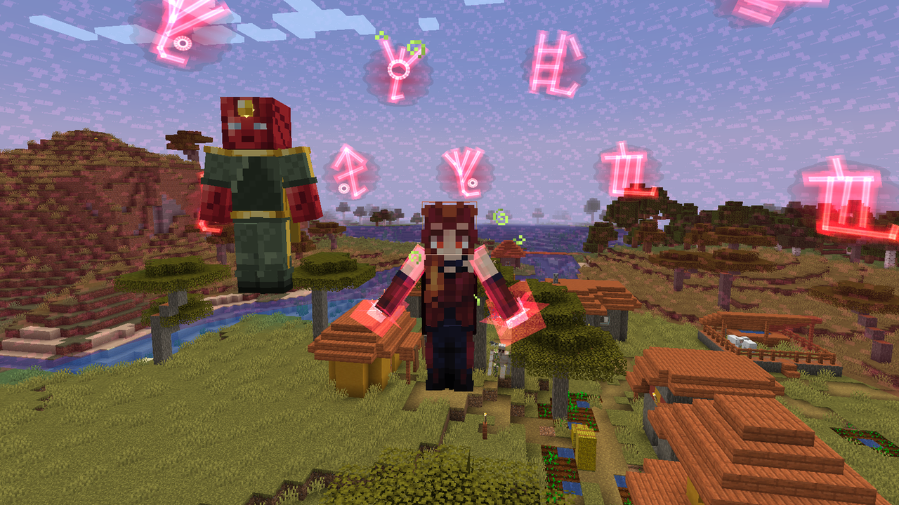

| | |
|---|---|
| 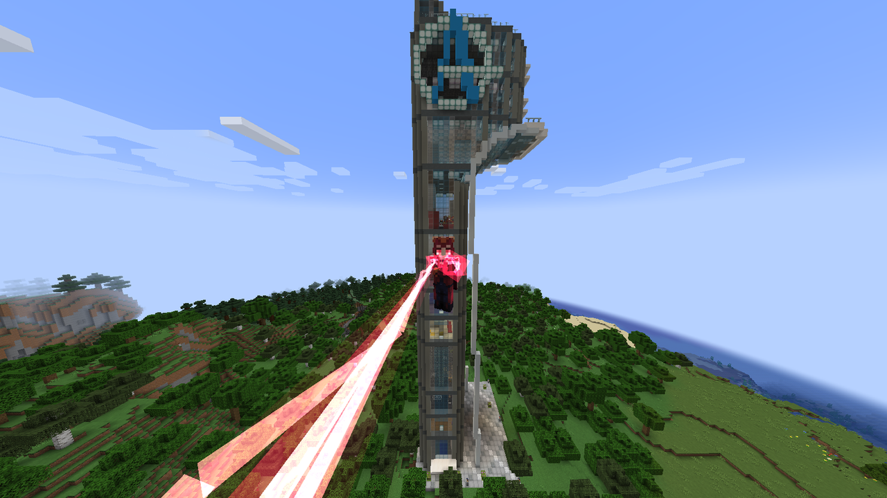 The Chaos Beam |  The Hex Barrier |
| 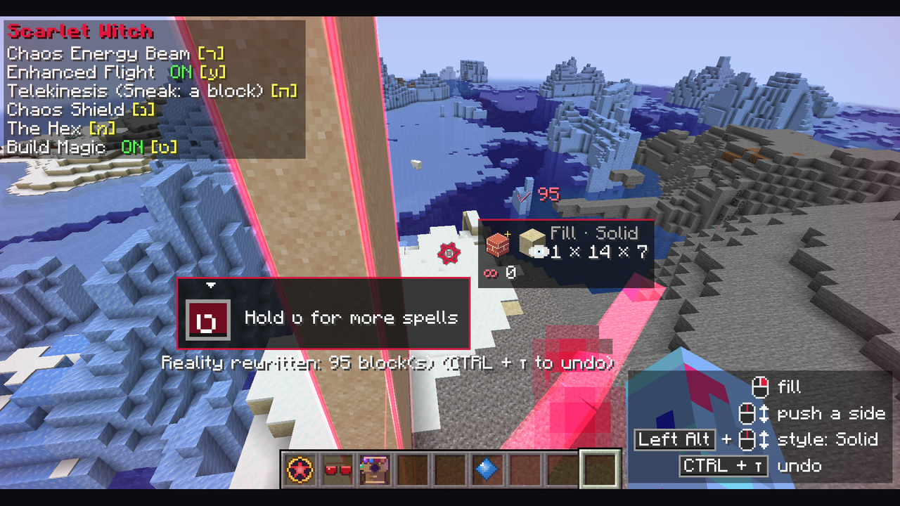 Build Magic: the spell hints on the HUD | 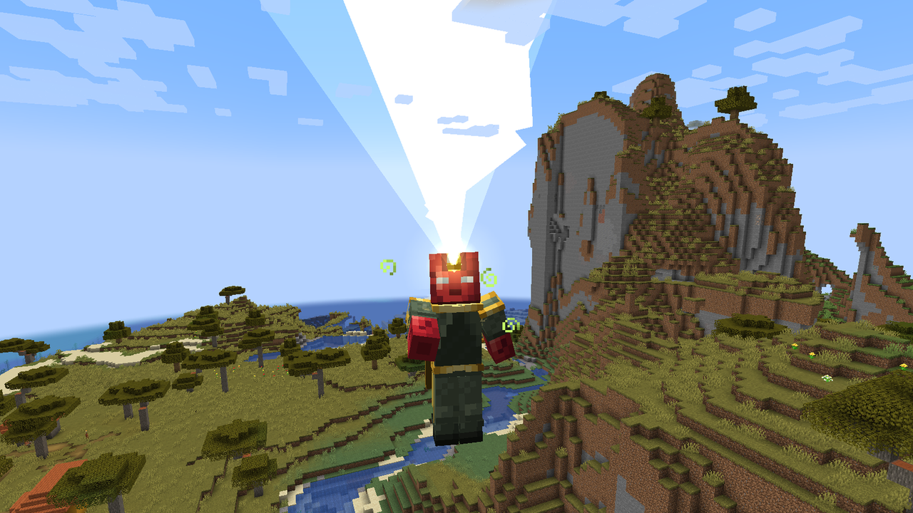 Vision's Mind Stone beam |
| 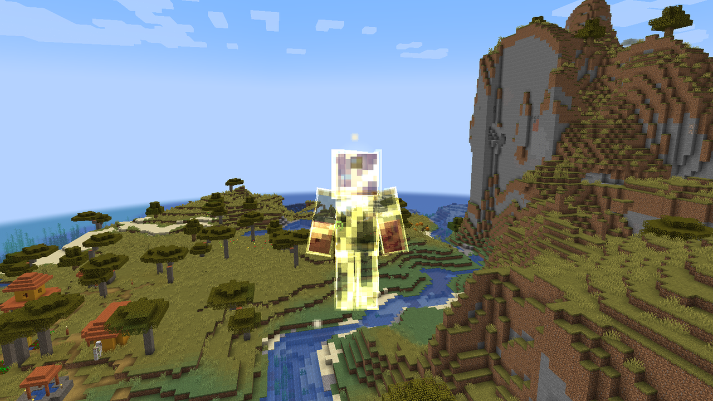 Vision phasing through a wall |  Magneto's magnetic shield |
| 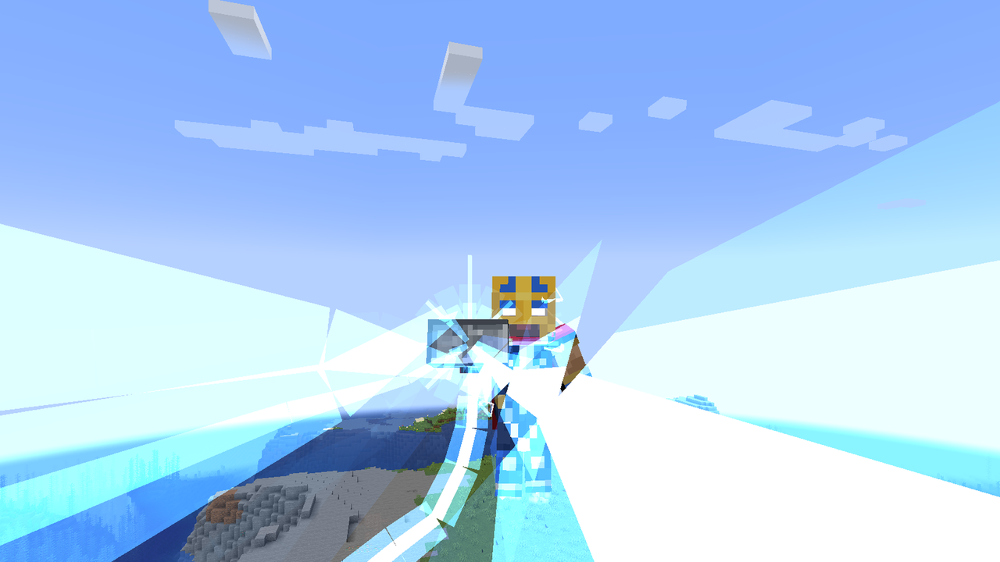 Thor's lightning | 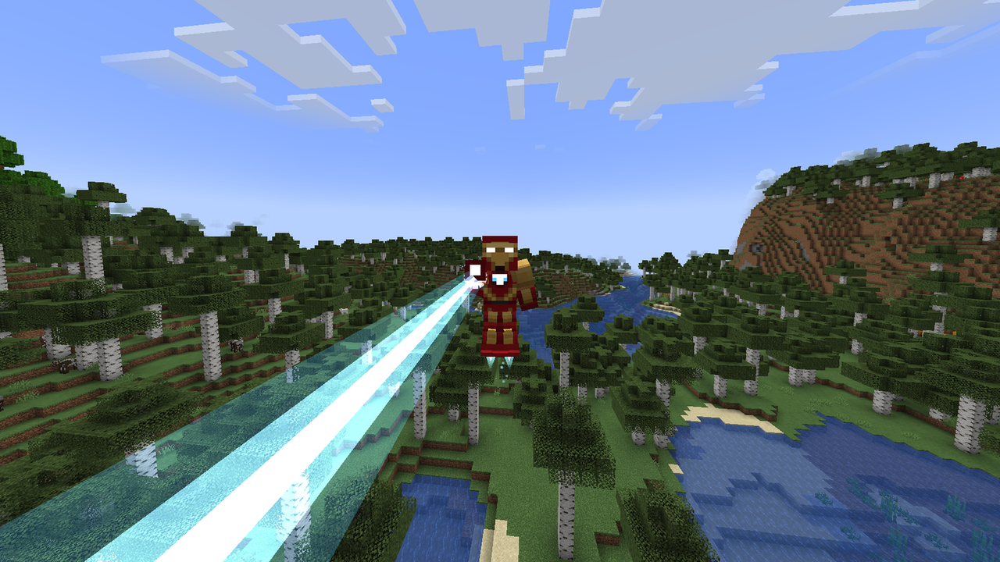 Iron Man's repulsor beam |
| 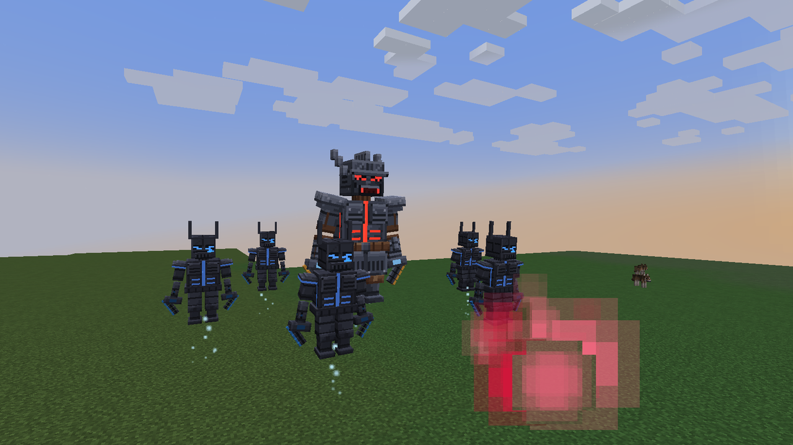 Ultron's army | 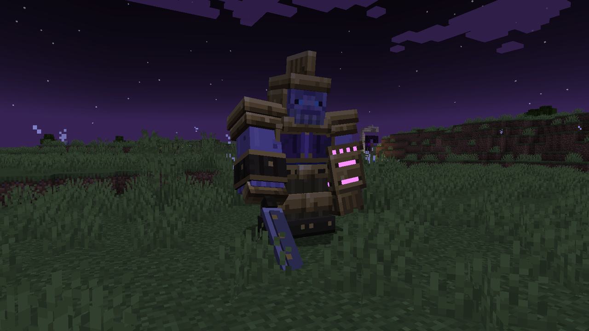 Thanos's armour |

## Quicksilver's song

Since 3.5 Quicksilver's Walkman plays his own original theme, *Silver Hours*, and Speed's plays
*Westview Blur*. Since 3.8.4 *Sweet Dreams (Are Made of This)* is no longer built into the mod. A
player who wants it puts their own copy in `config/enhanced/music/` as `sweet_dreams.mp3` (or `.ogg`
or `.wav`) and sets the client option `quicksilverSong = "sweet_dreams"`; without the file,
Quicksilver plays *Silver Hours* and the game says once where to put it.

To play a different song, start the game once (this creates the folder `config/enhanced/music/` in
your Minecraft folder) and put an `.mp3`, `.ogg` or `.wav` file there (`quicksilver.*`, `speed.*`,
`witches_road.*`, or any name for Quicksilver). A server can give every player its own songs from
`<world>/serverconfig/enhanced/music/` (`/enhanced music reload|list`). See [Music](docs/wiki/Music.md).

## Building

You need Java 21. The copy of the mod for Minecraft 26.3 is compiled with Java 25 (into Java 21 class files);
Gradle downloads a Java 25 by itself if none is installed.

GitHub Actions (`.github/workflows/build.yml`) runs the same build and the GameTests on every
push and pull request, and publishes a release for every push to `main` (or a `v*` tag).

```sh
./gradlew build              # the mod jar ends up in build/libs/
./gradlew runClient          # play in a development client
./gradlew runGameTestServer  # run the automated in-game tests
```

To install, copy `build/libs/enhanced-<version>.jar` into the `mods` folder of a NeoForge
1.21.1, 1.21.4, 1.21.11 or 26.3 instance (the jar holds a copy of the mod for each; see [docs/MULTIVERSION.md](docs/MULTIVERSION.md)).

How the heroes and bosses of 3.0 hang on the shared code (the plug-ins, the event priorities, the
boss framework and its rules) is in [docs/HEROES-AND-BOSSES.md](docs/HEROES-AND-BOSSES.md).

## Credits

* Hero concepts: Eilon Kolodkin-Gal.
* Scarlet Witch skin: the community skin
  ["Scarlet Witch"](https://www.minecraftskins.com/skin/18465369/scarlet-witch/) from minecraftskins.com.
* *Sweet Dreams (Are Made of This)*: Eurythmics. No longer built into the mod (3.8.4); a player can put
  their own copy in `config/enhanced/music/`.

## For server owners

* `/enhanced power get|set …` (`none`, `magneto`, `scarlet_witch`, `quicksilver`,
  `vision`, `tommy`, `billy`, `loki`, `thor`, `phoenix`, `spider_man`, `thanos`, `ultron`, `apocalypse`, `agatha`, `cyclops`, `professor_x`, `custom`, `heimdall`, `odin`, `hela`, `doctor_strange`, `hulk`, `wolverine`, `deadpool`, `captain_america`, `red_hulk`, `iron_man`, `falcon`, `love`, optionally followed by a look), `/enhanced look <players> <look>`
  (for example `/enhanced look @a tva`), `/enhanced hex list|clear` and `/enhanced boss start <thanos|ultron|apocalypse|hela> [force]`,
  `/enhanced boss stop`, `/enhanced boss list` and `/enhanced boss cleanup <center> <radius>`, which start, end, list and clean up
  boss fights, `/enhanced ward list|remove <player>` for the wards of the Book of the Vishanti, `/enhanced road status|enter|leave|reset|skip|set|layout|cells` for the Witches' Road, and since 3.5 `/enhanced asgard tp|state`, `/enhanced music reload|list` and `/enhanced structure repair_school`, and since 3.7 `/enhanced structure school_lab [radius]|force|status`, and since 3.8 `/enhanced serum open <player>`, `/enhanced eternity reset|send <player>` and `/enhanced structure refit_tower [radius] [force]|status` (operators only; everyone can type `/road leave` and `/road status`).
* Balance numbers (beam damage, Hex death chance and radius, the Vision of the Hex, flight speeds, shrapnel,
  how much Quicksilver Time slows the world, the Phoenix's Mind Reading, Mind Control and Burst, Spider-Man's webs, zip, swing, crawl, suits, legs, Instant Kill and Black Eyes, the rules every boss fight shares (`[boss]`), the Mad Titan's clock of stones and every move, Ultron's bodies, Sentries and the Sokovia lift, Apocalypse's shield, attacks and Horsemen and his master factor, and the three bosses' heroes, Billy's Hex Beam and Hex Barrier, the ten Build Magic ranks and Wanda's Instant level, the Book of the Vishanti and its wards, the Darkhold, the Witches' Road trials, and in 3.3 Agatha, Cyclops, Professor X, the Hex Runes and the Hero Creator's budget and limits, and in 3.4 whether a custom hero may take the heroes' abilities, world powers and look extras, how much strength changes them, and whether Choose a Hero gives items, and in 3.5 Asgard (`[asgard]`), who the Bifrost takes along (`[bifrost]`), Heimdall, Odin, Hela and her fight, the world's music, Loki's body and whether Agatha drains only sorcerers, and in 3.6 the Infinity Stones (`[stones]`, `[gauntlet]`, one section per stone, `[soul_stone]`), the stone sites (`[stone_sites]`), Doctor Strange, the Eye and the Sling Ring, the Hulk and the Gamma Emitter (`[hulk]`, `[gamma]`) and the Hydra soldiers (`[hydra]`), and in 3.7 the healing factor (`[healing_factor]`), Wolverine and his injection (`[wolverine]`, `[adamantium_injection]`), Deadpool and Dogpool (`[deadpool]`, `[dogpool]`), the X-Men lower lab (`[school_lab]`), the amplified Cerebro (`[professor_x]`), the Stone Locator (`[stone_locator]`), Agatha's Cottage (`[agatha_cottage]`) and meeting Death (`[death_meeting]`), and in 3.8 the Super Soldier Serum (`[super_soldier_serum]`), Captain America and his shield (`[captain_america]`, `[vibranium_shield]`), Red Hulk (`[red_hulk]`), Iron Man and each of his suits (`[iron_man]`, `[mark_1]`, `[mark_3]`, `[mark_5]`, `[mark_50]`, `[mark_85]`, `[hulkbuster]`), Falcon (`[falcon]`), the tower's armoury (`[avengers_tower]`), Eternity (`[eternity]`) and Love (`[love]`)…) are in `world/serverconfig/enhanced-server.toml`. The three structures of 3.3 are tuned by data packs (structure sets and biome tags); `/locate structure enhanced:sanctum|avengers_tower|end_tunnel|vormir_cliff` finds the stone sites of 3.6, `enhanced:agatha_cottage` the cottages of 3.7, and `enhanced:eternity_shrine` the shrines of 3.8 (in the End).
* Item, block and entity tags under `data/enhanced/tags/` decide what counts as
  metal, what can be lifted, what the shield repels and which bosses resist the Hex,
  so datapacks can change them.
