# Enhanced

A Minecraft mod where you can become one of the *Enhanced*:
**Magneto**, the Master of Magnetism; **Wanda Maximoff, the Scarlet Witch**;
**Quicksilver**, who runs so fast the world slows down around him (to *Sweet Dreams*);
or **Vision**, the Mind Stone in a synthetic body.
And if you're lucky enough to survive Wanda's Hex wall, **Photon**.

Original hero concepts by Eilon Kolodkin-Gal. The full design, with every rule and
number, is in [docs/DESIGN.md](docs/DESIGN.md) (Hebrew: [docs/DESIGN.he.md](docs/DESIGN.he.md)).

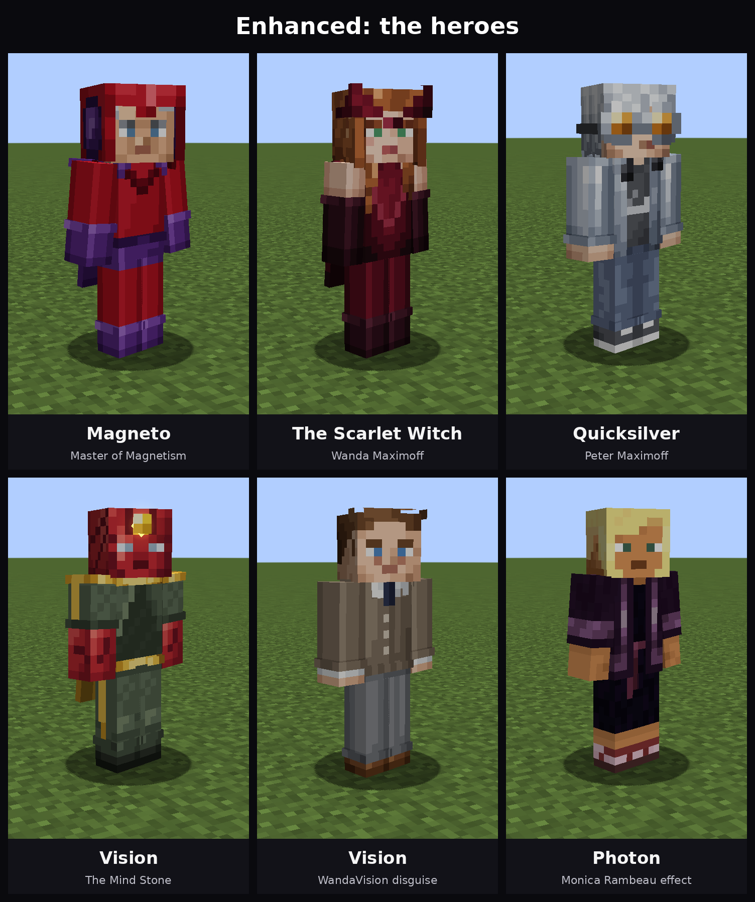

| Magneto | Scarlet Witch | The Hex |
|---|---|---|
| 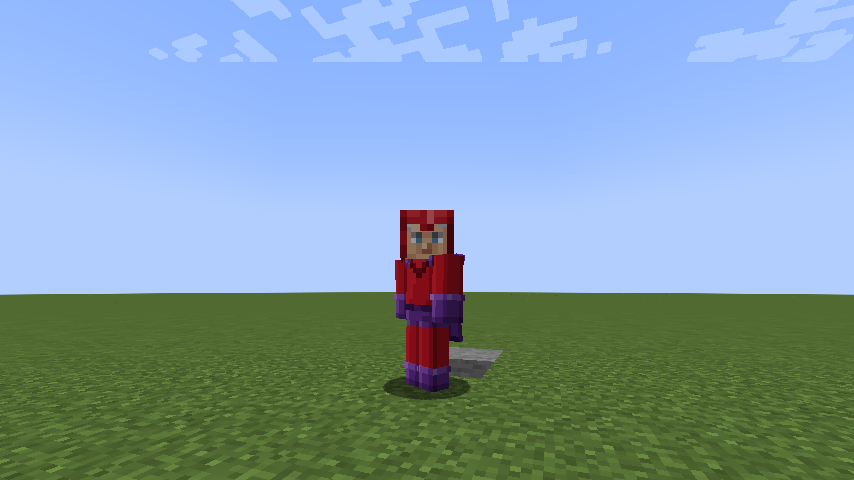 | 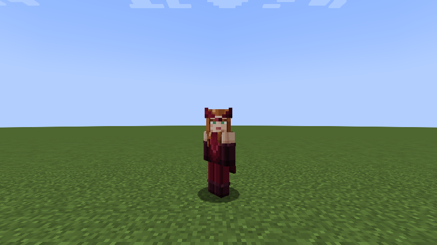 | 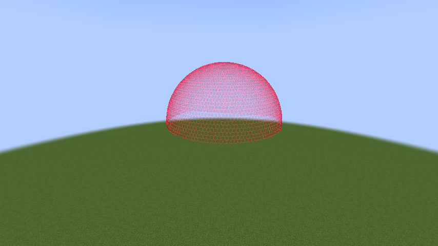 |

| Quicksilver | Vision | Quicksilver Time |
|---|---|---|
| 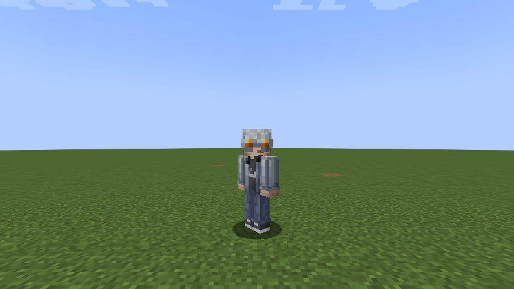 | 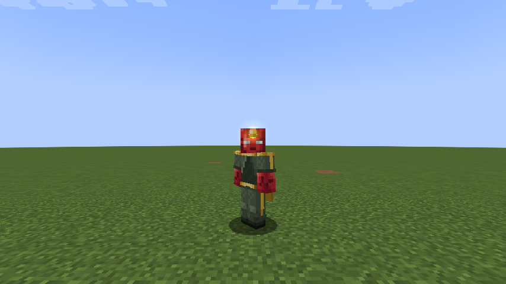 | 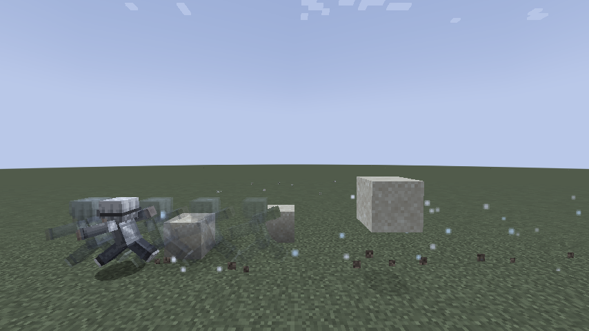 |

* **Minecraft** 1.21.1
* **Mod loader** NeoForge 21.1.x
* **Install it on** the client, plus the server for multiplayer

## Becoming a hero

| Hero | How |
|---|---|
| **Magneto** | Craft **Magneto's Helmet** from 5 Netherite Blocks (helmet shape) and put it on. |
| **Scarlet Witch** | Find the very rare **Scarlet Witch Gene** (mansions, strongholds, fortresses, bastions, ancient and End cities, jungle temples, desert pyramids, witches, evokers). Hold it in one hand and use **Loki's Scepter** (End City treasure and other rare chests) with the other to touch the Mind Stone. **Without the gene, you explode.** |
| **Photon** | Cross a Scarlet Witch's Hex wall without her permission and survive the 5% chance. |
| **Quicksilver** | Craft **Quicksilver's Goggles** (sugar, iron, glass panes, a Block of Diamond) and put them on. |
| **Vision** | Craft a **Synthezoid Core** (redstone blocks, netherite ingots, a Nether Star). Hold it in one hand and use **Loki's Scepter** with the other. |

## Controls

| Key | Magneto | Scarlet Witch | Photon | Quicksilver | Vision |
|---|---|---|---|---|---|
| **R** | Metal Telekinesis | Chaos Energy Beam (hold) | Photon Blast | Quicksilver Time on/off | Mind Stone Beam (hold) |
| **G** | Iron Shrapnel Storm (hold) | Enhanced Flight | Photon Flight | Speed Blitz | Flight |
| **V** | Armor & Weapon Strip | Telekinesis (creatures, items, blocks) | Energy Release | Pickpocket | Phase through walls (toggle) |
| **B** | Magnetic Shield (toggle) | Chaos Shield (hold) | Phase Shift | Wall & Water Run (toggle) | Density (toggle) |
| **N** | Magnetic Flight | The Hex (again: Hex Control, Sneak: dissolve) | Spectrum Vision (toggle) | Walkman: music on/off | Human disguise (toggle) |

**Quicksilver Time:** as Quicksilver, just sprint. Everything within 32 blocks slows to a
fifth of its speed (arrows hang in the air), you run four times faster, and the music starts.

Every hero except Quicksilver can also fly by double-tapping **Space**. With telekinesis, press the key again
to launch what you hold, or **Sneak** + the key to put it down gently. Keys can be changed
under *Options → Controls → Enhanced Powers*. The top-left corner of the screen always
shows your abilities, cooldowns and resources.

## Screenshots

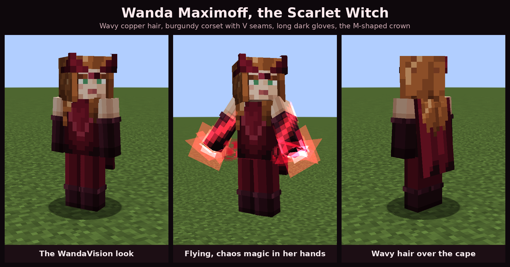

| | |
|---|---|
| 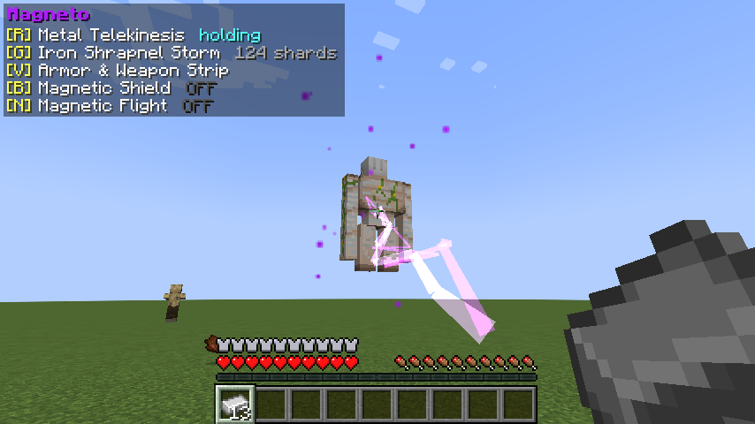 Magneto lifting an Iron Golem | 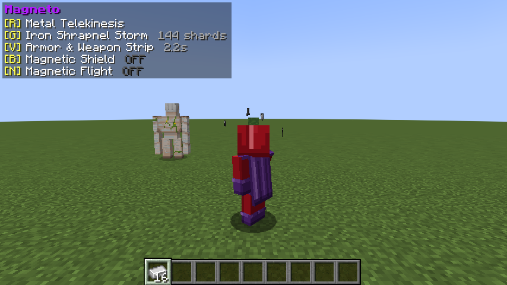 Ripping a zombie's iron gear off |
| 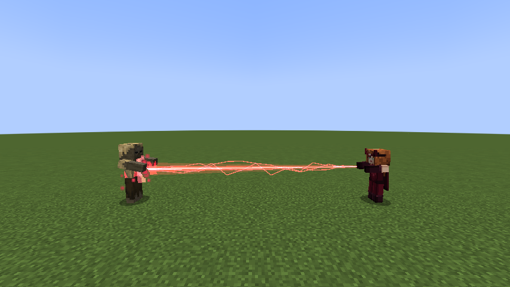 The Chaos Beam | 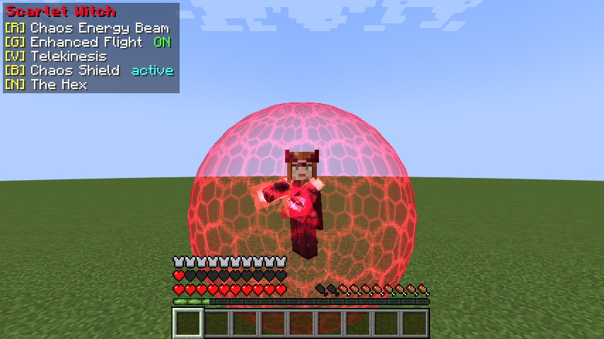 The Chaos Shield |
| 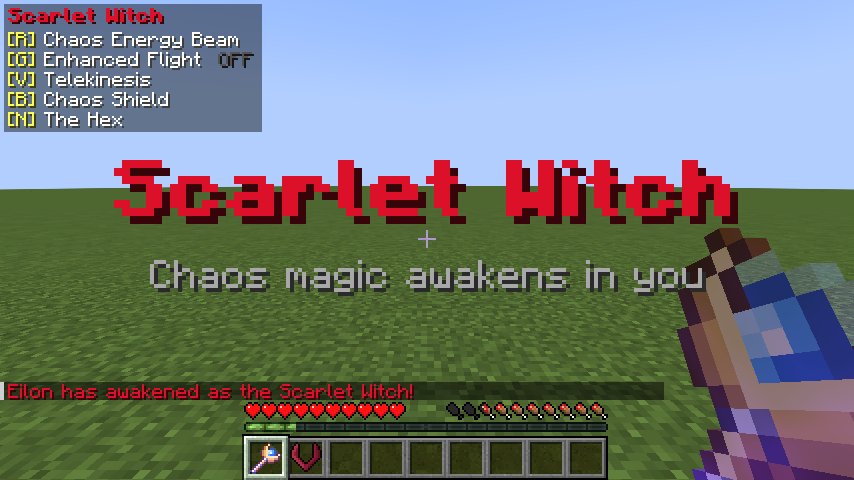 Touching the Mind Stone with the gene | 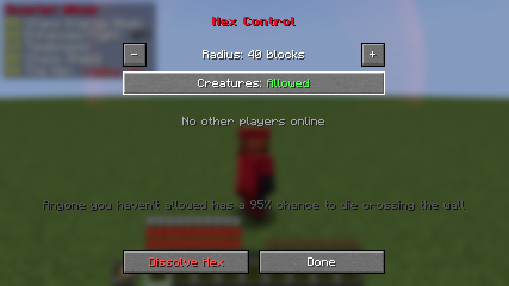 Wanda's Hex Control screen |
| 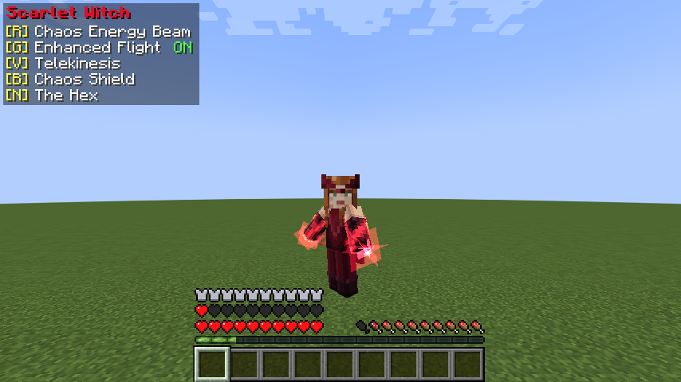 Red energy around Wanda's hands in flight | 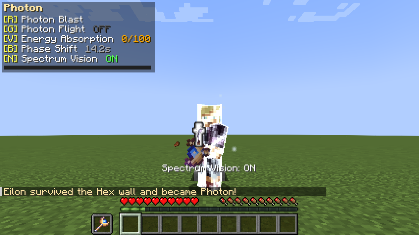 Photon phasing, with Spectrum Vision on |
| 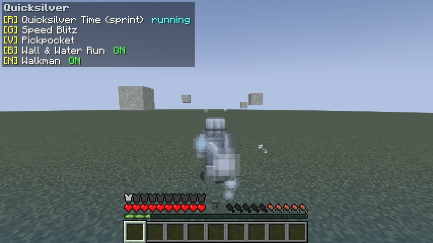 Quicksilver Time: sand and arrows hang in the air |  Quicksilver running past, as another player sees him |
| 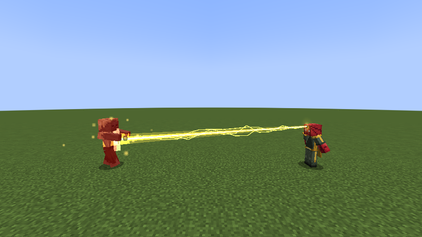 Vision's Mind Stone beam | 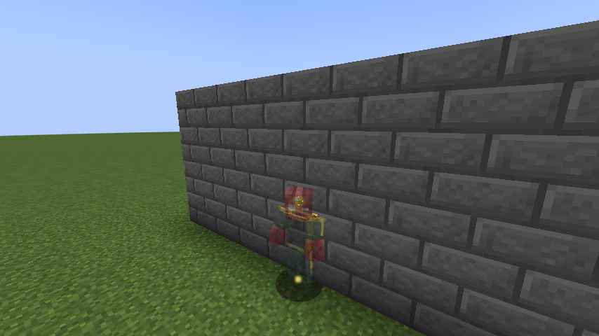 Vision phasing through a wall |
| 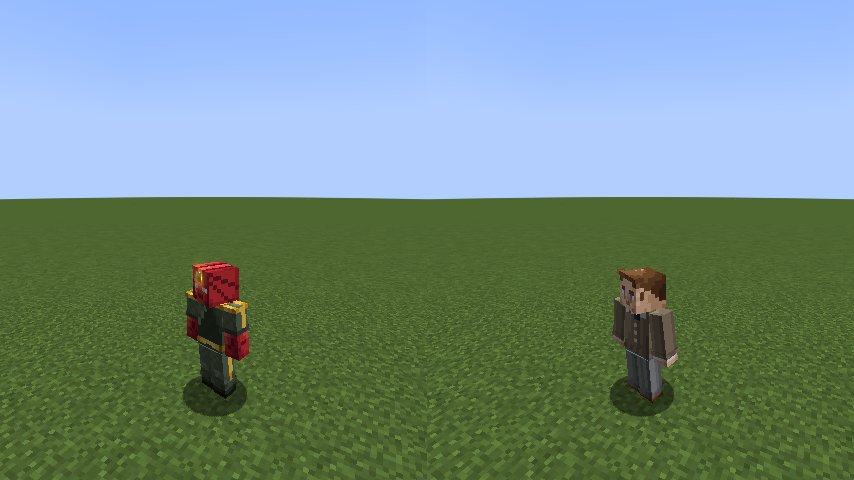 Vision and his WandaVision human disguise | |

## Quicksilver's song

Quicksilver's Walkman plays *Sweet Dreams (Are Made of This)* by Eurythmics, which is built into
the mod (`src/main/resources/assets/enhanced/sounds/quicksilver/sweet_dreams.ogg`).

The recording is copyrighted, so this repository and the mods built from it are for personal use
only. Keep the repository private and don't share the built jar publicly.

To play a different song, start the game once (this creates the folder `config/enhanced/music/` in
your Minecraft folder) and put an `.mp3`, `.ogg` or `.wav` file there. The first file in
alphabetical order is played; remove it to go back to *Sweet Dreams*.

## Building

You need Java 21.

```sh
./gradlew build              # the mod jar ends up in build/libs/
./gradlew runClient          # play in a development client
./gradlew runGameTestServer  # run the automated in-game tests
```

To install, copy `build/libs/enhanced-<version>.jar` into the `mods` folder of a NeoForge
1.21.1 instance.

## For server owners

* `/enhanced power get|set …` (`none`, `magneto`, `scarlet_witch`, `photon`, `quicksilver`,
  `vision`) and `/enhanced hex list|clear` (operators only).
* Balance numbers (beam damage, Hex death chance and radius, flight speeds, shrapnel, how much
  Quicksilver Time slows the world…) are in `world/serverconfig/enhanced-server.toml`.
* Item, block, entity and damage tags under `data/enhanced/tags/` decide what counts as
  metal, what can be lifted, what the shield repels, which bosses resist the Hex and
  which damage Photon absorbs, so datapacks can change them.
